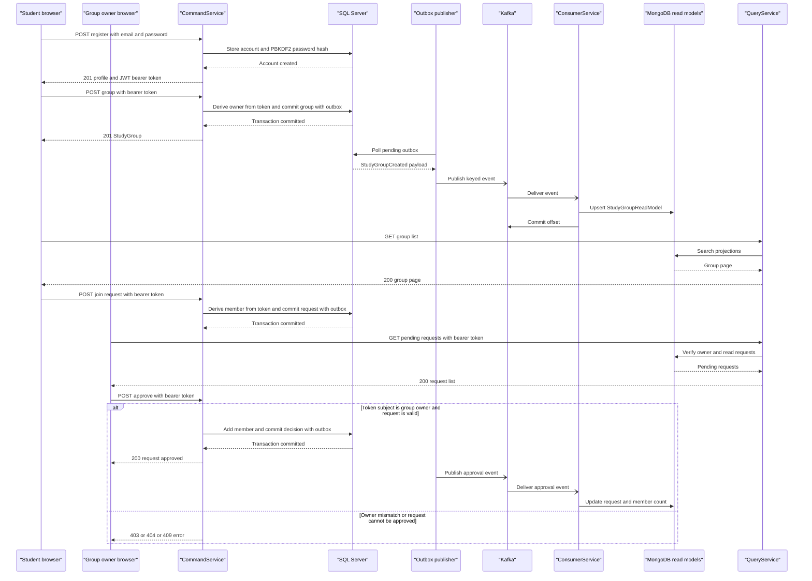

# API & Service Communication Contracts

The solution exposes separate command and query HTTP APIs, including account registration and login. JWT bearer tokens authenticate group commands and owner-only request operations; group changes are published asynchronously through Kafka and projected into MongoDB.

## Service Catalog

| Service | Port | Category | Purpose |
|---|---|---|---|
| CommandService | HTTP 5088; HTTPS 7123 in launch profile | Business and UI host | Register/login accounts, issue JWTs, accept group commands, and serve the demo UI |
| QueryService | HTTP 5135; HTTPS 7105 in launch profile | Business | Search/read group projections and expose owner-authorized join requests |
| ConsumerService | No HTTP port | Business / worker | Consume Kafka group events and update MongoDB projections |
| Kafka | 9092 | Infrastructure | Transport asynchronous group events |
| ZooKeeper | 2181 | Infrastructure | Coordinate the local Kafka broker |

The HTTP ports above are project launch-profile defaults. There is no API Gateway.

## API Endpoints Inventory

| Service | Method | Path | Request type | Response type |
|---|---|---|---|---|
| CommandService | POST | `/api/auth/register` | `RegisterRequest` body | `AuthenticationResponse`; 201, 400, 409 |
| CommandService | POST | `/api/auth/login` | `LoginRequest` body | `AuthenticationResponse`; 200, 400, 401 |
| CommandService | GET | `/api/auth/me` | Bearer token | `UserProfileResponse`; 200, 401 |
| CommandService | POST | `/api/groups` | `CreateStudyGroupRequest` body and bearer token | `StudyGroup`; 201, 400, 401 |
| QueryService | GET | `/api/groups/mine` | Bearer token | Owned groups, joined groups, pending requests sent by the user, and pending review count for owned groups; 200, 401 |
| CommandService | POST | `/api/groups/{groupId}/join-requests` | `CreateJoinRequestRequest` body and bearer token | `JoinRequest`; 201, 400, 401, 404, 409 |
| CommandService | POST | `/api/groups/{groupId}/join-requests/{requestId}/approve` | Route IDs and bearer token; no body | `JoinRequest`; 200, 401, 403, 404, 409 |
| CommandService | POST | `/api/groups/{groupId}/join-requests/{requestId}/reject` | Route IDs and bearer token; no body | `JoinRequest`; 200, 401, 403, 404, 409 |
| QueryService | GET | `/api/groups` | `search`, `page`, `pageSize` query parameters | Page envelope with items and total count; 200, 400 |
| QueryService | GET | `/api/groups/{id}` | Group ID route parameter | `StudyGroupReadModel`; 200, 404 |
| QueryService | GET | `/api/groups/{groupId}/join-requests` | Group ID, optional status, and owner bearer token | List of `JoinRequestReadModel`; 200, 400, 401, 403, 404 |

Search and group details are public read operations. Group commands require authentication; only the authenticated group owner can view pending requests or approve/reject them. No URL, header, or query-based API versioning scheme is configured.

## Management & Observability Endpoints

| Service | Endpoint | Custom metrics |
|---|---|---|
| CommandService | `/swagger` and `/swagger/v1/swagger.json` | None identified |
| QueryService | `/swagger` and `/swagger/v1/swagger.json` | None identified |
| ConsumerService | No HTTP management endpoint | None identified |

No health-check endpoint, metrics exporter, or tracing endpoint is configured.

## DTOs & Contracts

- `RegisterRequest` and `LoginRequest` are immutable request records. Passwords are accepted only by the authentication endpoints and are never included in account responses.
- `UserProfileResponse` exposes account ID, display name, email, and creation time. `AuthenticationResponse` returns this profile with a bearer access token and expiry.
- `CreateStudyGroupRequest` contains the group name, subject, goal, description, schedule, meeting mode, meeting location, level, and maximum member count. Owner and member IDs are derived from the validated JWT subject, not accepted from the request body.
- `StudyGroup` and `JoinRequest` are command-side models returned by group commands. `StudyGroupReadModel` and `JoinRequestReadModel` are query-side MongoDB projections.
- `StudyGroupCreatedEvent` and `StudyGroupEvent` are event contracts duplicated in CommandService and ConsumerService. Event type names and JSON property names are the cross-service contract; no schema registry or contract version field is present.
- CommandService serializes enum values as strings in HTTP responses. Swashbuckle generates OpenAPI at runtime; no checked-in OpenAPI or protobuf schema was found.

## Communication Patterns

- **Synchronous:** browser-to-CommandService for registration, login, and group commands; browser-to-QueryService for reads. The browser sends the JWT as an Authorization bearer token for protected calls. There is no gateway or response aggregation layer.
- **Asynchronous:** group writes place event payloads into SQL `OutboxMessages` in the same transaction as the domain write. `OutboxPublisher` polls pending messages and publishes keyed events to `study-group-events`. ConsumerService upserts the MongoDB projections.
- **Authentication:** CommandService stores email and PBKDF2-HMAC-SHA256 password hashes in SQL Server and issues 60-minute HMAC-SHA256 JWTs. QueryService validates the issuer, audience, signature, and expiry using the same signing key. The key must be supplied through local user-secrets or environment configuration, not committed to source control. The demo UI keeps the token in browser `sessionStorage`.
- **Authorization:** the command API derives the actor ID from the token subject. QueryService checks the same subject against the projected group owner before returning join requests. Group search and detail reads remain public.
- **Retry and delivery:** the outbox publisher polls every second and waits three seconds after a publish or database error. ConsumerService disables auto-commit, commits only after processing, and seeks back to a failed message before a two-second retry delay. Projection upserts make repeated events idempotent. There is no circuit breaker, dead-letter topic, or explicit database command timeout policy.
- **Discovery and gateway:** services use configured local endpoints; service discovery and API Gateway are absent.
- **Transport:** local HTTPS launch profiles and HTTPS redirection are configured for the APIs. Local Kafka uses plaintext; this setup is for a classroom demo and is not production deployment guidance.
- **Startup dependencies:** CommandService requires SQL Server; ConsumerService requires Kafka and MongoDB; QueryService requires MongoDB and the shared JWT signing key. MongoDB read results may lag the successful command response until the consumer processes its event.

## Service Technology Matrix

| Service | Web | Data access | Discovery | Gateway | Health checks | Cache | Metrics |
|---|---|---|---|---|---|---|---|
| CommandService | ASP.NET Core MVC | ADO.NET / SQL Server | None | None | None | None | None |
| ConsumerService | .NET hosted worker | MongoDB.Driver | None | None | None | None | None |
| QueryService | ASP.NET Core MVC | MongoDB.Driver | None | None | None | None | None |

## Service Communication Sequence

<!-- mermaid-checked: every participant uses `participant Id as "Label"`, no \n in aliases/messages/notes, every alt/opt/loop closed by end, no `:` inside any alias -->

