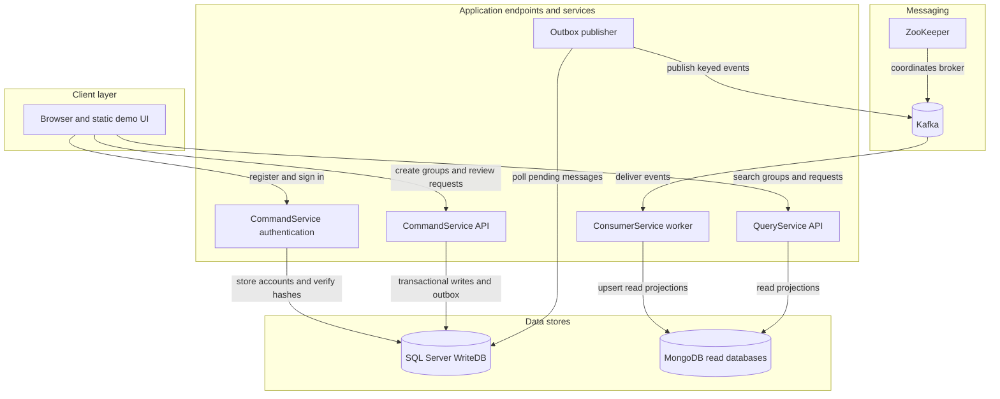
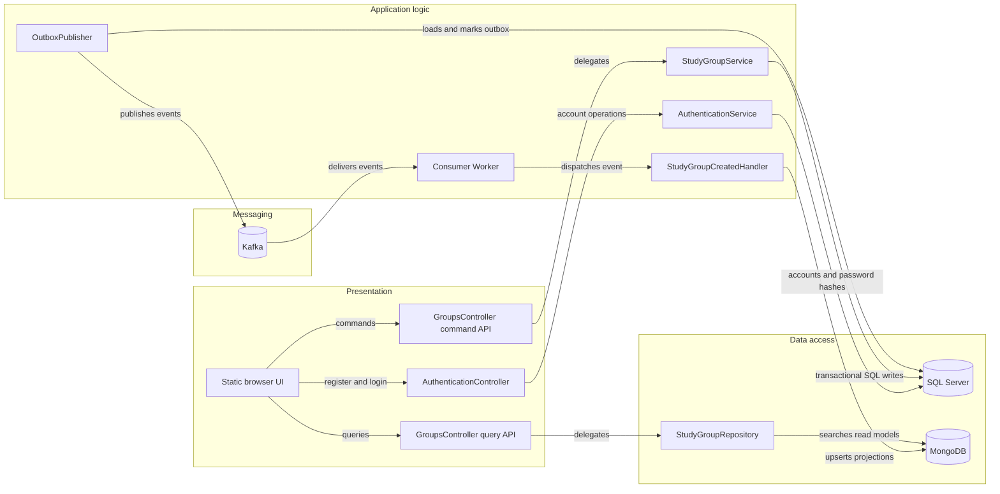

# Architecture Diagram

This solution is a .NET 9 microservices demo for study-group management with SQL-backed account registration and JWT authentication. It separates SQL write operations from MongoDB read projections and uses Kafka events to synchronize the read side.

## Application Architecture

<!-- mermaid-checked: no \n, no em-dash/en-dash, no {} in labels, subgraphs are id["label"], arrows are -->|"label"|, all subgraphs closed by end, ids unique -->

### Technology Stack Summary

| Layer | Technology | Version | Purpose |
|---|---|---:|---|
| Application | .NET / ASP.NET Core | .NET 9 | Command and query HTTP APIs |
| Command data access | Microsoft.Data.SqlClient | 7.1.1 | SQL Server access for accounts and study groups |
| Messaging | Confluent.Kafka | 2.15.1 | Publish outbox events and consume projections |
| Read data access | MongoDB.Driver | 3.12.0 | Upsert and query MongoDB read models |
| API documentation | Swashbuckle.AspNetCore | 10.2.3 | Swagger UI and OpenAPI |
| User interface | HTML, CSS, JavaScript | Not versioned | Demo pages served by CommandService |
| Local broker support | Kafka and ZooKeeper images | 7.4.0 | Local event transport |
| Relational storage | SQL Server | Not specified | Accounts, group write model, and transactional outbox |
| Document storage | MongoDB | Not specified | Study-group query projections |

### Data Storage & External Services

CommandService owns the `WriteDB` account, study-group, membership, join-request, and outbox tables. Account passwords are stored as PBKDF2 hashes; the authentication endpoints issue JWT bearer tokens. ConsumerService projects Kafka events into MongoDB collections in `study_group_read_db`; QueryService reads those projections. Kafka is the asynchronous transport and ZooKeeper coordinates the local broker. No cache or third-party HTTP service is configured.

### Key Architectural Decisions

- Group writes and outbox records share a SQL transaction; a background publisher retries pending messages so a broker outage does not discard a committed group change.
- Kafka consumers update MongoDB projections, while QueryService reads only those projections; read results are eventually consistent.
- There is no API Gateway or external identity provider. CommandService handles registration and token issuance; QueryService validates the shared JWT signature. The browser UI is hosted by CommandService and calls QueryService directly.

## Component Relationships

<!-- mermaid-checked: no \n, no em-dash/en-dash, no {} in labels, subgraphs are id["label"], arrows are -->|"label"|, all subgraphs closed by end, ids unique -->

### Component Inventory

| Component | Layer | Type | Responsibility |
|---|---|---|---|
| Static browser UI | Presentation | Static web content | Create groups, search, request membership, and review requests |
| CommandService `AuthenticationController` | Presentation | ASP.NET Core controller | Register accounts, issue JWTs, and return the current account |
| `AuthenticationService` | Business logic | Application service | Store accounts, verify PBKDF2 password hashes, and issue signed access tokens |
| CommandService `GroupsController` | Presentation | ASP.NET Core controller | Accept group and membership commands; map domain errors to HTTP status codes |
| `StudyGroupService` | Business logic | Application service | Enforce group rules and commit SQL changes with outbox events |
| `OutboxPublisher` | Business / infrastructure | Hosted background service | Publish pending SQL outbox messages to Kafka |
| `ConsumerService.Worker` | Infrastructure | Hosted background service | Consume study-group events, retry failures, and commit offsets |
| `StudyGroupCreatedHandler` | Data access | Event handler | Upsert group and join-request projections in MongoDB |
| QueryService `GroupsController` | Presentation | ASP.NET Core controller | Expose paginated group and join-request queries |
| `StudyGroupRepository` | Data access | MongoDB repository | Search groups and load group or join-request projections |
| Kafka | Infrastructure | Message broker | Transport asynchronous events |
| SQL Server | Data access | Relational database | Own accounts, group data, and outbox |
| MongoDB | Data access | Document database | Store group query projections |
