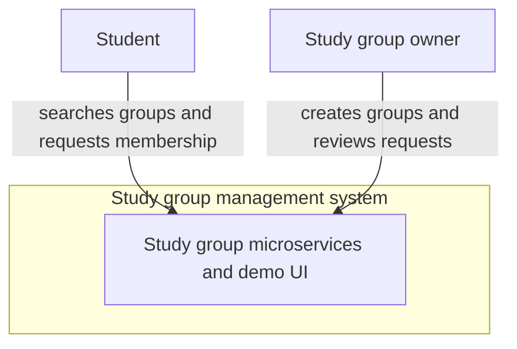
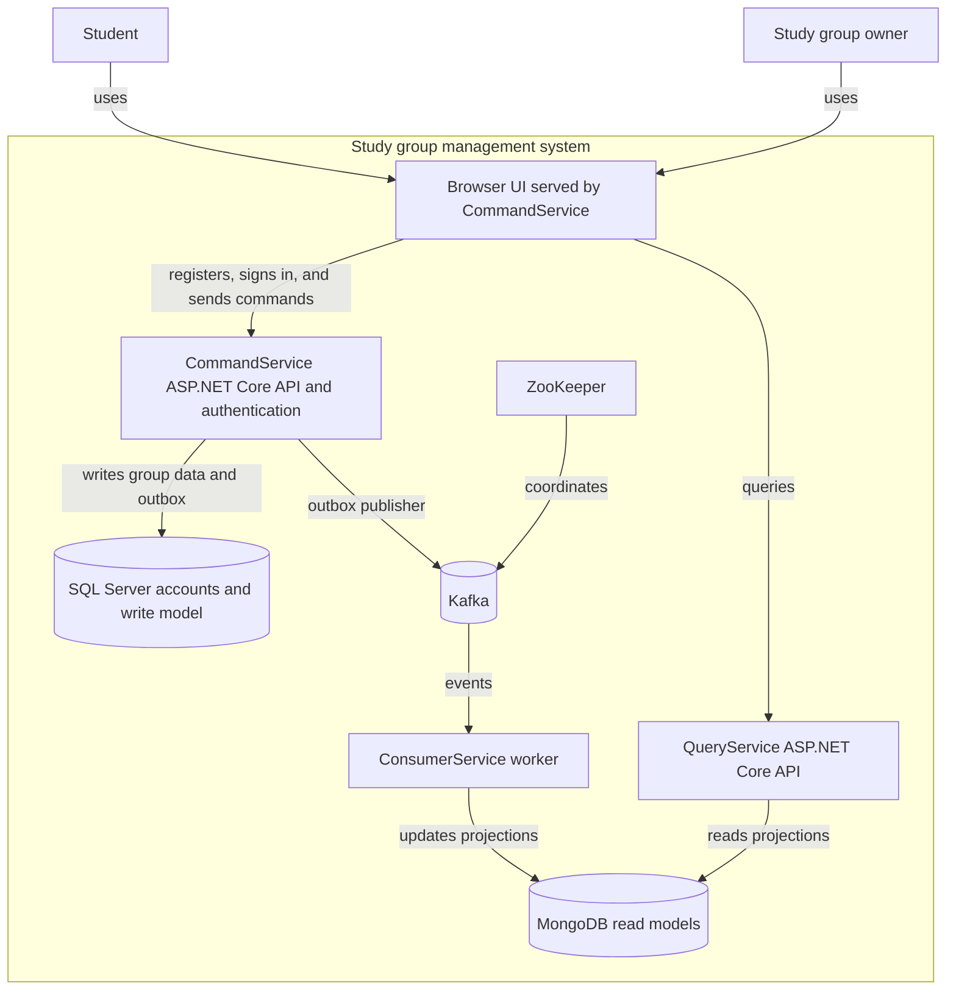
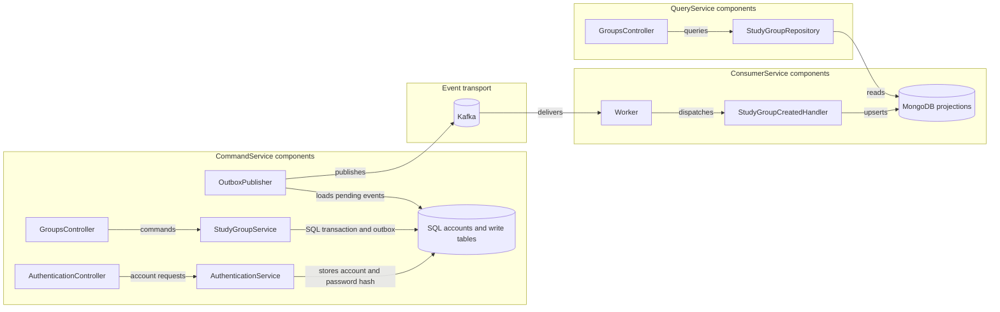

# C4 Model

The diagrams describe the implemented demo boundary: students and group owners use a browser, command and query APIs run separately, and Kafka connects SQL write state to MongoDB read projections. CommandService stores registered accounts and issues JWTs, which both APIs use for authentication. There is no API Gateway or external identity provider.

## Level 1 - System Context

<!-- mermaid-checked: no \n, no em-dash/en-dash, no {} in labels, subgraphs are id["label"], arrows are -->|"label"|, all subgraphs closed by end, ids unique -->

## Level 2 - Containers

<!-- mermaid-checked: no \n, no em-dash/en-dash, no {} in labels, subgraphs are id["label"], arrows are -->|"label"|, all subgraphs closed by end, ids unique -->

## Level 3 - Key Components

<!-- mermaid-checked: no \n, no em-dash/en-dash, no {} in labels, subgraphs are id["label"], arrows are -->|"label"|, all subgraphs closed by end, ids unique -->

### Container Responsibilities

| Container | Responsibility | Data boundary |
|---|---|---|
| Browser UI | Group creation, search, membership request, owner review | JWT kept in tab-scoped sessionStorage; no domain data stored locally |
| CommandService | Registration/login, JWT issuance, synchronous write API, and outbox publishing | SQL Server `WriteDB` accounts and group data |
| ConsumerService | Asynchronous event consumption and projection updates | MongoDB read collections |
| QueryService | Read-only group and request API | MongoDB read collections |
| Kafka and ZooKeeper | Event transport and broker coordination | Event messages and offsets |
