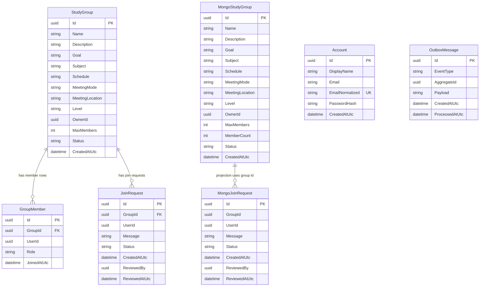

# Data Architecture & Persistence Layer

Account credentials and the study-group write model are stored in SQL Server, while group read projections are stored in MongoDB. The solution uses direct ADO.NET for SQL access and MongoDB.Driver for projections; passwords are stored as PBKDF2 hashes, not plaintext.

## Database Configuration

| Service/Module | DB Type | Profile | Driver | Connection | Migration Tool |
|---|---|---|---|---|---|
| CommandService | SQL Server | Local default and Development | Microsoft.Data.SqlClient 7.1.1 | Local SQL Server instance; database `WriteDB` | None; account and group tables and indexes are initialized with SQL DDL at startup |
| ConsumerService | MongoDB | Local default | MongoDB.Driver 3.12.0 | Local MongoDB instance | None; collections are created by MongoDB on first write |
| QueryService | MongoDB | Local default and Development | MongoDB.Driver 3.12.0 | Local MongoDB instance | None; read collections are created by MongoDB on first write |

Development settings do not override the database connection sections. No SQL Server version, MongoDB version, connection pool tuning, or schema migration tool is specified in the project configuration.

## Data Ownership per Service

| Service | Tables or collections owned | ORM Framework | Caching | Notes |
|---|---|---|---|---|
| CommandService | SQL `Accounts`, `StudyGroups`, `GroupMembers`, `JoinRequests`, `OutboxMessages` | ADO.NET / Microsoft.Data.SqlClient | None | Owns accounts and group writes; group changes and outbox events commit together |
| ConsumerService | MongoDB `study_group_read_db.study_groups`, `study_group_read_db.join_requests` | MongoDB.Driver | None | Applies group events using upsert operations |
| QueryService | Reads MongoDB `study_group_read_db.study_groups`, `study_group_read_db.join_requests` | MongoDB.Driver | None | Read-only access to group projections; validates bearer tokens |

## Entity Model

SQL group entities and MongoDB projections are shown together for comparison. MongoDB projections are separate documents; their matching identifiers do not create database-enforced foreign keys.

<!-- mermaid-checked: every attribute is `<type> <name> [<key>] ["<description>"]` with at most one of PK/FK/UK, no \n in descriptions, no {} in descriptions, every relationship label is double-quoted -->

`Account` is created and queried by `CommandService/Services/AuthenticationService.cs`; group entities are defined in `CommandService/Models/StudyGroup.cs`, `CommandService/Models/GroupMember.cs`, and `CommandService/Models/JoinRequest.cs`. MongoDB projections are represented by `ConsumerService/Models/StudyGroupReadModel.cs`, `ConsumerService/Models/JoinRequestReadModel.cs`, and the corresponding QueryService model files. Account identifiers are referenced by group rows as GUIDs, without SQL foreign keys.

`OutboxMessage.AggregateId` is a logical correlation key, not a SQL foreign key. Password hashes use PBKDF2-HMAC-SHA256 with a per-account random salt and fixed-time comparison during login.

## Key Repository Methods

| Service | Repository or data component | Notable methods | Purpose |
|---|---|---|---|
| CommandService | `AuthenticationService` in `CommandService/Services/AuthenticationService.cs` | `RegisterAsync`; `LoginAsync`; `GetByIdAsync` | Create accounts, verify password hashes, issue JWTs, and load the authenticated account |
| QueryService | `StudyGroupRepository` in `QueryService/Repositories/StudyGroupRepository.cs` | `SearchAsync(search, page, pageSize)`; `GetByIdAsync(id)`; `GetJoinRequestsAsync(groupId, status)` | Search and page group projections, load one group, and filter projected requests |
| CommandService | `StudyGroupService` in `CommandService/Services/StudyGroupService.cs` | `CreateAsync`; `CreateJoinRequestAsync`; `ReviewJoinRequestAsync` | Execute transactional SQL commands and append corresponding outbox events |
| CommandService | `OutboxPublisher` in `CommandService/Services/OutboxPublisher.cs` | `GetNextPendingAsync`; `MarkProcessedAsync` | Poll and mark outbox events around Kafka publication |
| ConsumerService | `StudyGroupCreatedHandler` in `ConsumerService/Handlers/StudyGroupCreatedHandler.cs` | `HandleAsync(StudyGroupCreatedEvent)`; `HandleAsync(StudyGroupEvent)` | Idempotently upsert group and request projections |

## Caching Strategy

No in-memory, distributed, or query-result cache is configured. MongoDB serves as the persistent read projection, not as a cache with a TTL or eviction policy.

## Data Ownership Boundaries

CommandService owns SQL `Accounts`, the group write tables, and the outbox in `WriteDB`. ConsumerService updates the MongoDB read projections, and QueryService reads those documents without accessing SQL. This is a CQRS boundary with eventual consistency. Account GUIDs are used as group owner/member identifiers, but no SQL foreign keys link accounts to group records.

### Data Classification & Sensitivity

| Entity | Sensitive fields | Classification | Controls in place |
|---|---|---|---|
| Account | `Email`, `DisplayName` | PII; `PasswordHash` is credential data | Password is PBKDF2-hashed with a random salt; no application-level field encryption or masking |
| StudyGroup | `OwnerId`; description may contain user-entered content | Potential PII | Authenticated account ID is assigned by the API; no field masking |
| GroupMember | `UserId` | Potential PII | User ID comes from the authenticated token; no field masking |
| JoinRequest | `UserId`, `ReviewedBy`, message text | Potential PII | User IDs come from the token; owner-only review/list checks; no field masking |
| OutboxMessage | Event payload contains account identifiers and user-entered content | Potential PII | No payload encryption or redaction configured |

No PHI or PCI fields were identified in the inspected models. Database-level encryption at rest is not configured by this application. JWT signing keys are configured through local user-secrets and are not stored in source control.
