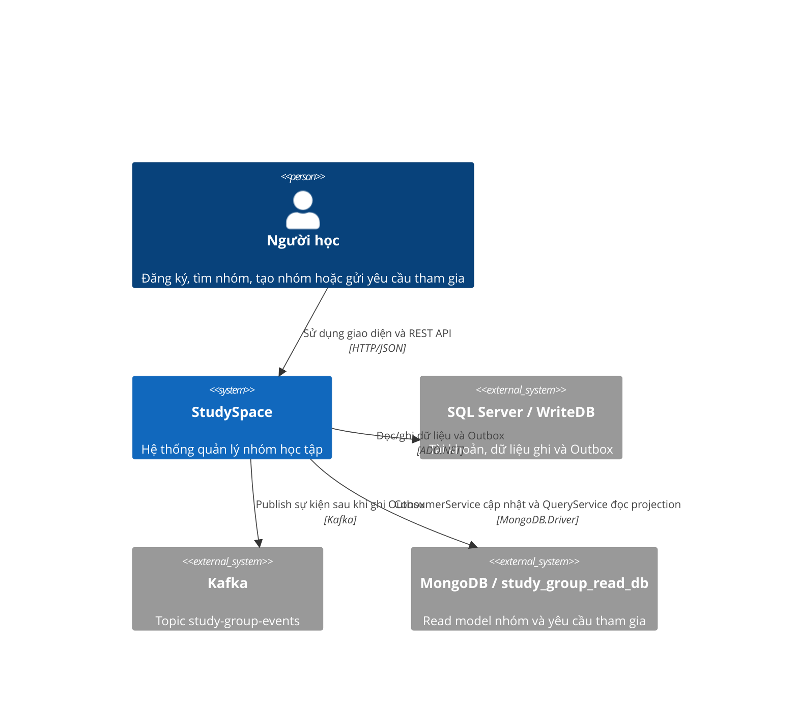
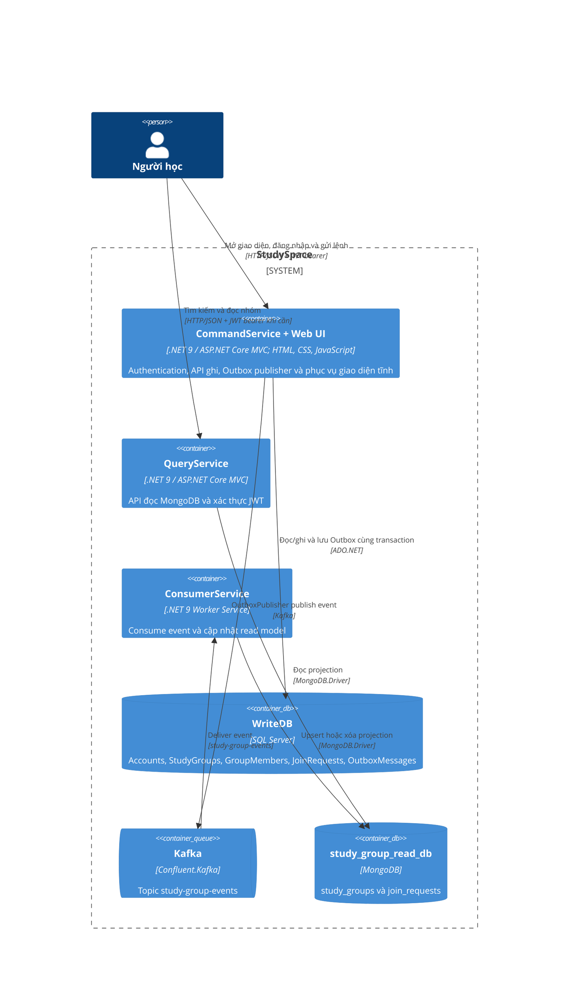
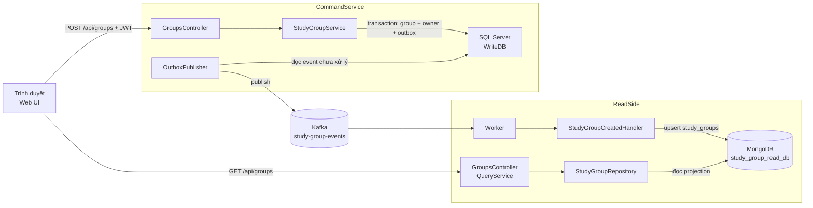
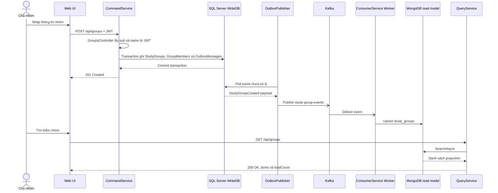
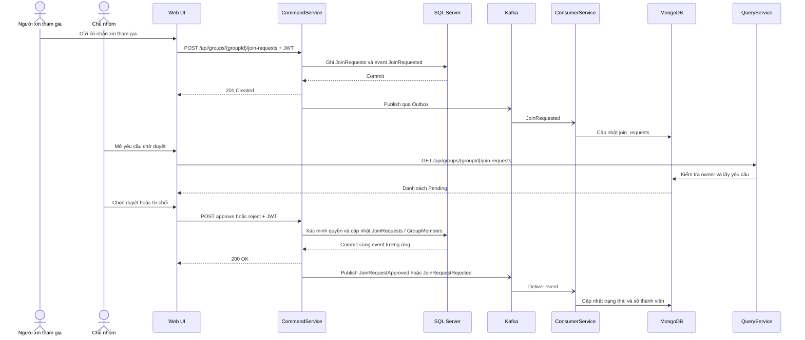
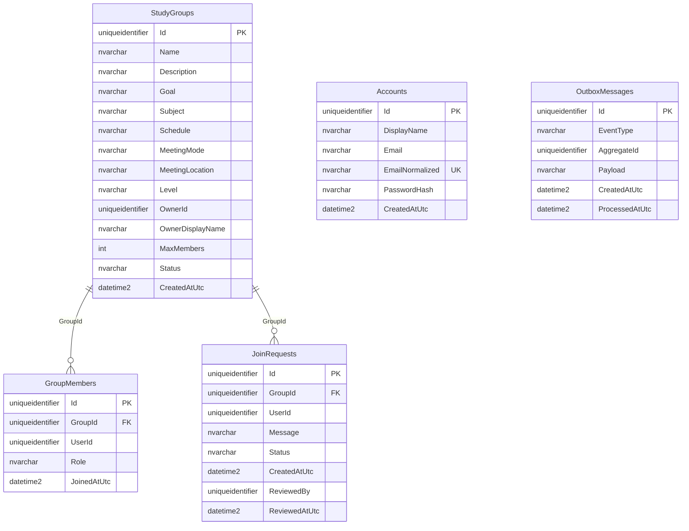
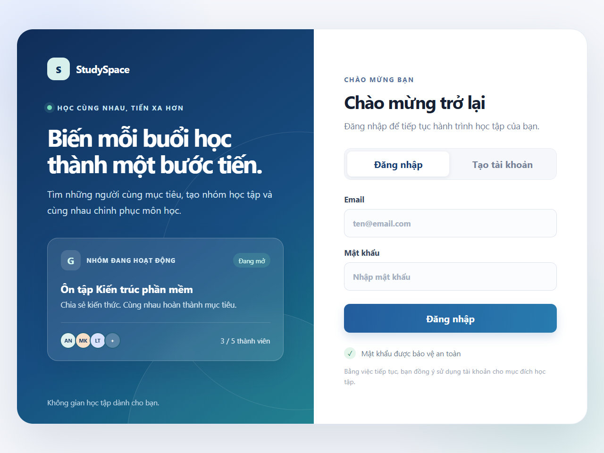
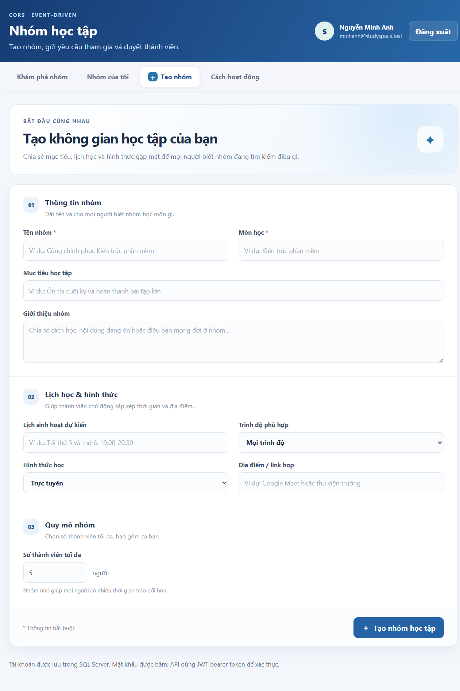
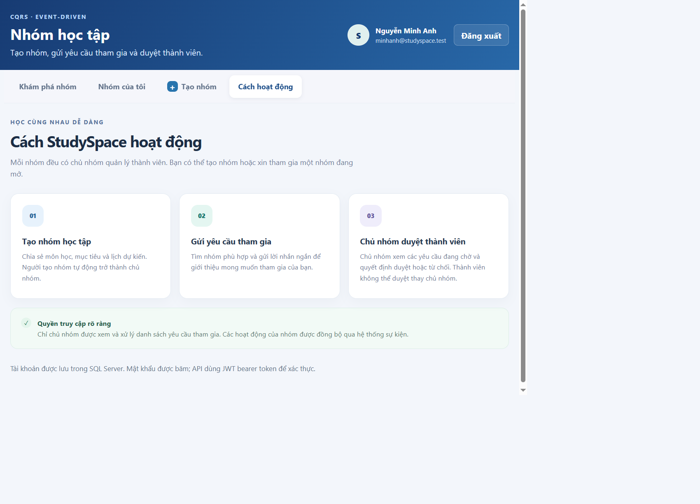

# STUDYSPACE — HỆ THỐNG QUẢN LÝ NHÓM HỌC TẬP

## 1. Tổng quan

StudySpace là ứng dụng web giúp người học khám phá, tạo và tham gia các nhóm học tập. Chủ nhóm có thể xem, duyệt hoặc từ chối yêu cầu tham gia; thành viên đã được duyệt có thể rời nhóm. Hệ thống tách luồng ghi và đọc theo CQRS, lưu dữ liệu ghi trong SQL Server, đồng bộ các sự kiện nghiệp vụ qua Kafka và xây dựng read model trong MongoDB.

Đây là dự án demo phục vụ học tập môn **Kiến trúc và Thiết kế phần mềm**. Các thông tin công nghệ, API, dữ liệu và sơ đồ bên dưới được viết theo source hiện tại của Nhóm 9, không lấy thông số kỹ thuật từ dự án tham khảo.

### Mục tiêu

- Tổ chức ứng dụng thành các service có trách nhiệm riêng.
- Cung cấp REST API cho đăng nhập, quản lý nhóm và truy vấn dữ liệu.
- Lưu dữ liệu ghi và dữ liệu đọc theo hai mô hình riêng.
- Sử dụng Kafka để chuyển sự kiện thay đổi nhóm sang read model.
- Xây dựng giao diện demo tiếng Việt cho người dùng.
- Mô tả kiến trúc bằng sơ đồ C4, sequence diagram và ERD.

### Công nghệ chính

| Thành phần | Công nghệ thực tế |
|---|---|
| Backend | .NET 9, ASP.NET Core MVC Controllers |
| Service ghi | CommandService, Microsoft.Data.SqlClient 7.1.1 |
| Service đọc | QueryService, MongoDB.Driver 3.12.0 |
| Consumer | ConsumerService, .NET Worker Service |
| Message broker | Apache Kafka; Confluent.Kafka 2.15.1 |
| CSDL ghi | SQL Server, database `WriteDB` |
| CSDL đọc | MongoDB, database `study_group_read_db` |
| API documentation | Swashbuckle.AspNetCore 10.2.3 |
| Frontend | HTML, CSS, JavaScript thuần; phục vụ từ `CommandService\wwwroot` |
| Hạ tầng chạy local | Docker Compose với `confluentinc/cp-kafka:7.4.0` và `confluentinc/cp-zookeeper:7.4.0`; script Python `chay_du_an.py` |

Frontend hiện không có `package.json` hoặc bước build npm. Dự án không dùng API Gateway, RabbitMQ, Entity Framework Core hoặc một dự án test tự động riêng.

## 2. Cấu trúc và thành phần hệ thống

### Các project

| Project | Vai trò | Dữ liệu / giao tiếp |
|---|---|---|
| **CommandService** | Đăng ký, đăng nhập, phát JWT; nhận lệnh tạo nhóm, gửi yêu cầu, duyệt/từ chối, xóa nhóm và rời nhóm; phục vụ giao diện web | Ghi SQL Server `WriteDB`; ghi event vào bảng Outbox; publish Kafka |
| **QueryService** | Tìm kiếm nhóm, xem chi tiết, lấy nhóm của người dùng và yêu cầu chờ duyệt | Đọc các collection MongoDB trong `study_group_read_db`; kiểm tra JWT ở các API riêng tư |
| **ConsumerService** | Worker nền nhận event từ Kafka và cập nhật read model | Đọc topic `study-group-events`; upsert hoặc xóa MongoDB projection |
| **Kafka** | Vận chuyển sự kiện bất đồng bộ | Broker local tại `localhost:9092` |
| **ZooKeeper** | Điều phối broker theo cấu hình Docker Compose hiện tại | Local tại `localhost:2181` |
| **SQL Server** | Lưu tài khoản, dữ liệu nhóm ghi và Outbox | Mặc định `SIU\SQLEXPRESS`, database `WriteDB` |
| **MongoDB** | Lưu projection phục vụ truy vấn | Mặc định `mongodb://localhost:27017/` |

Các API là những service riêng biệt nhưng giao diện gọi trực tiếp CommandService và QueryService. Không có lớp Gateway đứng giữa hai service.

### Công nghệ và phiên bản trong project file

| Project | Target framework | Thư viện có khai báo trực tiếp |
|---|---|---|
| `CommandService` | `net9.0` | `Microsoft.AspNetCore.Authentication.JwtBearer` 9.0.12; `Confluent.Kafka` 2.15.1; `Microsoft.Data.SqlClient` 7.1.1; `Swashbuckle.AspNetCore` 10.2.3 |
| `QueryService` | `net9.0` | `Microsoft.AspNetCore.Authentication.JwtBearer` 9.0.12; `MongoDB.Driver` 3.12.0; `Swashbuckle.AspNetCore` 10.2.3 |
| `ConsumerService` | `net9.0` | `Confluent.Kafka` 2.15.1; `Microsoft.Extensions.Hosting` 10.0.12; `Microsoft.Extensions.Hosting.Abstractions` 10.0.12; `MongoDB.Driver` 3.12.0 |

Các version trên là version được khai báo trực tiếp trong `.csproj`; đây không phải danh sách đầy đủ các thư viện phụ thuộc bắc cầu.

## 3. C4 Model

### Level 1 — System Context



### Level 2 — Container



### Level 3 — Component xử lý lệnh tạo nhóm

Tên component dưới đây bám theo các class trong source: `GroupsController`, `StudyGroupService`, `OutboxPublisher`, `Worker`, `StudyGroupCreatedHandler`, `StudyGroupRepository`.



## 4. API và quy ước giao tiếp

Các route dưới đây được khai báo trong Controllers. Địa chỉ mặc định là `http://localhost:5088` cho CommandService và `http://localhost:5135` cho QueryService.

| Service | Method | Endpoint | Quyền / kết quả chính |
|---|---|---|---|
| CommandService | `POST` | `/api/auth/register` | Công khai; tạo tài khoản và trả `201 Created` cùng profile/JWT; email trùng trả `409` |
| CommandService | `POST` | `/api/auth/login` | Công khai; trả `200 OK` và JWT; thông tin đăng nhập sai trả `401` |
| CommandService | `GET` | `/api/auth/me` | Cần JWT; trả profile tài khoản hiện tại |
| CommandService | `POST` | `/api/groups` | Cần JWT; tạo nhóm, người tạo trở thành chủ nhóm; trả `201 Created` |
| CommandService | `DELETE` | `/api/groups/{groupId}` | Cần JWT của chủ nhóm; xóa vĩnh viễn dữ liệu ghi liên quan; trả `204 No Content` |
| CommandService | `DELETE` | `/api/groups/{groupId}/members/me` | Cần JWT của thành viên; rời nhóm; trả `204`; chủ nhóm không thể dùng thao tác này |
| CommandService | `POST` | `/api/groups/{groupId}/join-requests` | Cần JWT; gửi yêu cầu tham gia; trả `201 Created` |
| CommandService | `POST` | `/api/groups/{groupId}/join-requests/{requestId}/approve` | Cần JWT chủ nhóm; duyệt yêu cầu hợp lệ; trả `200 OK` |
| CommandService | `POST` | `/api/groups/{groupId}/join-requests/{requestId}/reject` | Cần JWT chủ nhóm; từ chối yêu cầu hợp lệ; trả `200 OK` |
| QueryService | `GET` | `/api/groups?search=&page=1&pageSize=20` | Công khai; tìm theo tên, môn học, mục tiêu hoặc mô tả; `pageSize` tối đa 100 |
| QueryService | `GET` | `/api/groups/{id}` | Công khai; lấy chi tiết nhóm; không tìm thấy trả `404` |
| QueryService | `GET` | `/api/groups/mine` | Cần JWT; trả nhóm làm chủ, nhóm đã tham gia, yêu cầu đang gửi và số yêu cầu cần duyệt |
| QueryService | `GET` | `/api/groups/{groupId}/join-requests?status=Pending` | Cần JWT của chủ nhóm; xem yêu cầu theo trạng thái |

API sử dụng JSON. Danh tính người dùng và chủ nhóm được lấy từ claim của JWT, không nhận `OwnerId` hoặc `UserId` tùy ý từ giao diện. Không có API Gateway, route versioning hay endpoint health-check tùy chỉnh. Swagger UI được cung cấp tại `/swagger` trên từng API service.

Ví dụ request thủ công có trong [CommandService\CommandService.http](CommandService/CommandService.http) và [QueryService\QueryService.http](QueryService/QueryService.http).

## 5. Sequence diagram

### 5.1 Đăng ký và đăng nhập

```mermaid
sequenceDiagram
  actor User as Người học
  participant UI as Web UI
  participant Auth as AuthenticationController
  participant Service as AuthenticationService
  participant SQL as SQL Server
  User->>UI: Nhập tên, email và mật khẩu
  UI->>Auth: POST /api/auth/register
  Auth->>Service: RegisterAsync
  Service->>Service: Chuẩn hóa email và băm mật khẩu PBKDF2
  Service->>SQL: INSERT Accounts
  SQL-->>Service: Tài khoản được tạo
  Service-->>UI: 201 + profile + JWT bearer
  UI->>UI: Lưu session trong sessionStorage
  opt Đăng nhập ở phiên sau
    User->>UI: Nhập email và mật khẩu
    UI->>Auth: POST /api/auth/login
    Auth->>Service: LoginAsync
    Service->>SQL: SELECT tài khoản theo email chuẩn hóa
    SQL-->>Service: Tài khoản và password hash
    Service->>Service: Xác minh hash và tạo JWT
    Service-->>UI: 200 + profile + JWT bearer
  end
  end
```

### 5.2 Tạo nhóm và cập nhật read model



Lệnh ghi có thể trả về trước khi ConsumerService hoàn tất cập nhật MongoDB. Vì vậy, truy vấn ngay sau khi tạo nhóm có thể chưa thấy dữ liệu mới trong một khoảng thời gian ngắn (eventual consistency).

### 5.3 Yêu cầu tham gia và chủ nhóm duyệt



## 6. Database diagram và cấu trúc dữ liệu

### 6.1 ERD phía ghi — SQL Server



`GroupMembers.GroupId` và `JoinRequests.GroupId` có foreign key tới `StudyGroups.Id`. `UserId`, `OwnerId`, `ReviewedBy` là GUID tham chiếu logic tới tài khoản; source hiện không khai báo foreign key giữa các bảng nhóm và `Accounts`.

### 6.2 Bảng SQL và ràng buộc chính

| Bảng | Cột (kiểu dữ liệu; nullable nếu có) | Khóa / ràng buộc |
|---|---|---|
| `Accounts` | `Id uniqueidentifier`; `DisplayName nvarchar(100)`; `Email nvarchar(320)`; `EmailNormalized nvarchar(320)`; `PasswordHash nvarchar(256)`; `CreatedAtUtc datetime2` | `Id` là PK; unique index `UX_Accounts_EmailNormalized`; password được lưu dưới dạng PBKDF2 hash |
| `StudyGroups` | `Id uniqueidentifier`; `Name nvarchar(100)`; `Description nvarchar(1000)`; `Goal nvarchar(300)`; `Subject nvarchar(100)`; `Schedule nvarchar(200)`; `MeetingMode nvarchar(20)`; `MeetingLocation nvarchar(300)`; `Level nvarchar(20)`; `OwnerId uniqueidentifier`; `OwnerDisplayName nvarchar(100)`; `MaxMembers int`; `Status nvarchar(20)`; `CreatedAtUtc datetime2` | `Id` là PK; `MaxMembers >= 1`; `MeetingMode` thuộc `Online`, `InPerson`, `Hybrid`; `Level` thuộc `All`, `Beginner`, `Intermediate`, `Advanced`; `Status` thuộc `Active`, `Closed`; index `IX_StudyGroups_Subject_Status` |
| `GroupMembers` | `Id uniqueidentifier`; `GroupId uniqueidentifier`; `UserId uniqueidentifier`; `Role nvarchar(20)`; `JoinedAtUtc datetime2` | `Id` là PK; FK `GroupId` → `StudyGroups.Id`; unique `(GroupId, UserId)`; `Role` thuộc `Owner`, `Member`; index `IX_GroupMembers_UserId` |
| `JoinRequests` | `Id uniqueidentifier`; `GroupId uniqueidentifier`; `UserId uniqueidentifier`; `Message nvarchar(1000)`; `Status nvarchar(20)`; `CreatedAtUtc datetime2`; `ReviewedBy uniqueidentifier NULL`; `ReviewedAtUtc datetime2 NULL` | `Id` là PK; FK `GroupId` → `StudyGroups.Id`; `Status` thuộc `Pending`, `Approved`, `Rejected`, `Cancelled`; unique filtered index `UX_JoinRequests_Pending_User` trên `(GroupId, UserId)` khi `Status = Pending` |
| `OutboxMessages` | `Id uniqueidentifier`; `EventType nvarchar(100)`; `AggregateId uniqueidentifier`; `Payload nvarchar(max)`; `CreatedAtUtc datetime2`; `ProcessedAtUtc datetime2 NULL` | `Id` là PK; filtered index `IX_OutboxMessages_Pending` trên `CreatedAtUtc` khi `ProcessedAtUtc IS NULL` |

Các bảng và index được khởi tạo/cập nhật bằng SQL DDL khi CommandService chạy; không sử dụng EF Core migrations. Database `WriteDB` phải được tạo sẵn trước khi chạy service.

### 6.3 Read model — MongoDB

| Database | Collection | Trường dữ liệu chính |
|---|---|---|
| `study_group_read_db` | `study_groups` | `_id` (GUID); `Name`; `Description`; `Goal`; `Subject`; `Schedule`; `MeetingMode`; `MeetingLocation`; `Level`; `OwnerId`; `OwnerDisplayName`; `MaxMembers`; `MemberCount`; `Status`; `CreatedAtUtc` |
| `study_group_read_db` | `join_requests` | `_id` (GUID); `GroupId`; `UserId`; `Message`; `Status`; `CreatedAtUtc`; `ReviewedBy`; `ReviewedAtUtc` |

Hai collection là projection do ConsumerService cập nhật và QueryService đọc. `GroupId` trong `join_requests` là tham chiếu logic, không phải foreign key do MongoDB cưỡng chế. Read model được cập nhật theo event nên có thể trễ so với SQL write model.

## 7. Event-Driven và luồng sự kiện

CommandService ghi thay đổi nghiệp vụ và payload vào `OutboxMessages` trong cùng transaction SQL. `OutboxPublisher` publish event chưa xử lý lên topic `study-group-events`; ConsumerService nhận message và cập nhật MongoDB projection. Cơ chế này tránh tình huống ghi dữ liệu SQL thành công nhưng không lưu lại ý định phát event.

| Event type | Nơi phát sinh | Consumer xử lý |
|---|---|---|
| `StudyGroupCreated` | Tạo nhóm mới | Tạo/upsert document trong `study_groups` |
| `StudyGroupOwnerUpdated` | Backfill tên chủ nhóm cho dữ liệu cũ lúc khởi động CommandService | Cập nhật `OwnerDisplayName` trong projection |
| `JoinRequested` | Thành viên gửi yêu cầu tham gia | Tạo/upsert document trong `join_requests` |
| `JoinRequestApproved` | Chủ nhóm duyệt yêu cầu | Cập nhật trạng thái yêu cầu và số thành viên trong nhóm |
| `JoinRequestRejected` | Chủ nhóm từ chối yêu cầu | Cập nhật trạng thái yêu cầu |
| `MemberLeft` | Thành viên rời nhóm | Cập nhật trạng thái yêu cầu liên quan và số thành viên |
| `GroupDeleted` | Chủ nhóm xóa nhóm | Xóa projection nhóm và các yêu cầu liên quan khỏi MongoDB |

Consumer tắt auto-commit và chỉ commit offset sau khi xử lý message. Nếu xử lý lỗi, consumer log lỗi, seek lại vị trí message và thử lại sau thời gian chờ. Hệ thống hiện không có schema registry, dead-letter topic hoặc circuit breaker.

## 8. Pattern áp dụng và giới hạn

| Pattern / kỹ thuật | Cách áp dụng thực tế | Nhận xét |
|---|---|---|
| Microservices | Tách CommandService, QueryService và ConsumerService thành các project .NET riêng | Có thể chạy riêng; giao diện gọi trực tiếp API, chưa có Gateway |
| CQRS | Lệnh ghi qua CommandService và SQL Server; truy vấn qua QueryService và MongoDB read model | Đọc/ghi tách store; dữ liệu đọc eventual consistency |
| Event-Driven | Kafka topic `study-group-events` vận chuyển các thay đổi nhóm | Tách producer và consumer; cần theo dõi độ trễ projection |
| Transactional Outbox | Event được lưu cùng transaction với thay đổi dữ liệu SQL | Giữ lại event cần publish nếu broker tạm thời không sẵn sàng |
| Repository / Service layer | `StudyGroupService` xử lý lệnh; `StudyGroupRepository` truy vấn read model | Tách xử lý nghiệp vụ khỏi controller |
| MVC Controllers | `AuthenticationController` và `GroupsController` định nghĩa REST endpoints | ASP.NET Core MVC; không phải Minimal API |
| JWT authentication | CommandService cấp bearer token; QueryService xác minh cùng issuer, audience và signing key | JWT hết hạn theo cấu hình mặc định sau 60 phút |
| Database separation | Write model SQL và read model MongoDB tách theo mục đích | Không phải Database-per-Service đầy đủ: QueryService và ConsumerService cùng dùng `study_group_read_db` |

## 9. Giao diện demo

Ảnh dưới đây được chụp từ giao diện StudySpace chạy local, không dùng ảnh của dự án tham khảo. Ảnh thể hiện các màn hình frontend; dữ liệu tài khoản hiển thị ở các ảnh sau đăng nhập chỉ là dữ liệu minh họa trên trình duyệt, không phải tài khoản được tạo trong database.

### Đăng nhập và đăng ký



### Tạo nhóm học tập

Form cho phép nhập môn học, mục tiêu, giới thiệu, lịch sinh hoạt, trình độ, hình thức gặp mặt, địa điểm hoặc đường dẫn họp và sĩ số tối đa.



### Hướng dẫn sử dụng



Các chức năng giao diện:

- Đăng ký, đăng nhập, xem thông tin tài khoản và đăng xuất khỏi phiên hiện tại.
- Khám phá, tìm kiếm và phân trang danh sách nhóm.
- Tạo nhóm với thông tin học tập và lịch sinh hoạt chi tiết.
- Gửi yêu cầu tham gia kèm lời nhắn.
- Xem riêng nhóm làm chủ, nhóm đã tham gia và yêu cầu đang chờ.
- Chủ nhóm xem yêu cầu, duyệt/từ chối hoặc xóa vĩnh viễn nhóm.
- Thành viên đã tham gia có thể rời nhóm; chủ nhóm không được rời như thành viên.
- Thẻ nhóm hiển thị tên chủ nhóm và vai trò của người dùng trong nhóm.

JWT của phiên demo được lưu trong `sessionStorage` trên trình duyệt. Đăng xuất xóa token ở phía client; API không có endpoint logout riêng.

## 10. Chạy thử và kiểm chứng

### Yêu cầu môi trường

- Windows với .NET 9 SDK và ASP.NET Core 9 Runtime.
- Python để chạy script tiện ích `chay_du_an.py`.
- SQL Server instance `SIU\SQLEXPRESS` và database `WriteDB` đã tạo.
- MongoDB chạy tại `localhost:27017`.
- Docker Desktop để chạy Kafka và ZooKeeper theo `docker-compose.yml`.

### Cách nhanh: chạy toàn bộ bằng Python

Từ thư mục gốc `D:\HocTap\KTVTKPM\CQRS`, chạy:

```powershell
python chay_du_an.py
```

Script kiểm tra môi trường, bật các phụ thuộc local được cấu hình và chạy ba project .NET. Khi sẵn sàng, mở [http://localhost:5088/](http://localhost:5088/). Giữ cửa sổ script mở trong thời gian sử dụng; nhấn **Ctrl+C** để dừng các service .NET do script khởi chạy. SQL Server, MongoDB và Kafka/ZooKeeper có thể vẫn tiếp tục chạy.

### Cách thủ công

1. Khởi động SQL Server và xác nhận database `WriteDB` đã tồn tại. CommandService tự tạo/cập nhật các bảng, nhưng không tạo database.
2. Khởi động MongoDB, đảm bảo địa chỉ `mongodb://localhost:27017/` truy cập được.
3. Mở Docker Desktop, sau đó tại thư mục gốc chạy:

   ```powershell
   docker compose up -d
   docker compose ps
   ```

4. Thiết lập cùng một JWT signing key an toàn cho CommandService và QueryService. Nếu chuyển máy hoặc chưa cấu hình key, chạy lệnh sau một lần tại thư mục solution:

   ```powershell
   $rng = [System.Security.Cryptography.RandomNumberGenerator]::Create()
   $bytes = New-Object byte[] 32
   $rng.GetBytes($bytes)
   $key = [Convert]::ToBase64String($bytes)
   $rng.Dispose()
   dotnet user-secrets set "Authentication:SigningKey" $key --project CommandService
   dotnet user-secrets set "Authentication:SigningKey" $key --project QueryService
   Remove-Variable key, bytes, rng
   ```

   Không ghi signing key vào `appsettings.json`, Git hoặc README.

5. Mở ba terminal tại thư mục gốc và chạy từng service:

   ```powershell
   dotnet run --project CommandService --launch-profile http
   ```

   ```powershell
   dotnet run --project QueryService --launch-profile http
   ```

   ```powershell
   dotnet run --project ConsumerService
   ```

6. Truy cập giao diện và Swagger:

   - Web UI và CommandService: [http://localhost:5088/](http://localhost:5088/)
   - CommandService Swagger: [http://localhost:5088/swagger](http://localhost:5088/swagger)
   - QueryService Swagger: [http://localhost:5135/swagger](http://localhost:5135/swagger)

### Cổng và địa chỉ cấu hình mặc định

| Service / dependency | HTTP | HTTPS | Ghi chú |
|---|---:|---:|---|
| CommandService | `5088` | `7123` | HTTP profile phục vụ UI và API command |
| QueryService | `5135` | `7105` | API query; port khai báo trong launch profile |
| ConsumerService | Không có | Không có | Background worker, không mở HTTP listener |
| Kafka | `9092` | — | Listener PLAINTEXT theo Docker Compose |
| ZooKeeper | `2181` | — | Coordination service |
| MongoDB | `27017` | — | Địa chỉ local trong appsettings |
| SQL Server | Theo cấu hình instance | — | `SIU\SQLEXPRESS`; không ấn định port trong source |

Nếu dùng port khác, cần cập nhật URL `queryApi` của frontend và `Cors:AllowedOrigins` trong `QueryService\appsettings.json`.

### Kịch bản kiểm tra thủ công

1. Đăng ký tài khoản đầu tiên trên giao diện; đăng ký thành công sẽ tự đăng nhập.
2. Tạo một nhóm và kiểm tra chủ nhóm được gán theo tài khoản đã đăng nhập.
3. Đăng ký hoặc đăng nhập tài khoản thứ hai, tìm nhóm và gửi yêu cầu tham gia.
4. Trở lại tài khoản chủ nhóm, mở tab **Nhóm của tôi** và duyệt hoặc từ chối yêu cầu.
5. Chờ ConsumerService xử lý event, sau đó làm mới danh sách để kiểm tra read model.
6. Kiểm tra quyền: chủ nhóm có thể xóa nhóm; thành viên có thể rời nhóm; thành viên thường không thể xử lý yêu cầu; chủ nhóm không thể dùng thao tác rời nhóm.
7. Kiểm tra API bằng Swagger hoặc các request mẫu trong file `.http`.

### Tài khoản demo

Database local có các tài khoản minh họa để kiểm tra quyền sở hữu và vai trò trong nhóm `Phan quyen demo`:

| Email | Vai trò / trạng thái | Quyền kiểm tra |
|---|---|---|
| `owner.demo@studyspace.test` | Chủ nhóm (`Owner`) | Xem, duyệt hoặc từ chối yêu cầu tham gia |
| `member.demo@studyspace.test` | Thành viên (`Member`) | Thành viên không được duyệt yêu cầu của nhóm |
| `applicant.demo@studyspace.test` | Chưa là thành viên | Có yêu cầu tham gia chờ chủ nhóm duyệt |

Mật khẩu demo được cung cấp riêng khi thiết lập, không lưu trong source code hoặc README. Đây là dữ liệu dùng cho máy local, không sử dụng cho tài khoản thật hay môi trường production.

Repository hiện có ba project ứng dụng và các file `.http`; chưa phát hiện project test tự động riêng trong solution. Các kiểm tra trên là kịch bản chạy thử thủ công, không thay thế automated integration tests.

## 11. Giới hạn và hướng phát triển

- Kafka local đang dùng PLAINTEXT, phù hợp demo local, không phải cấu hình production.
- MongoDB không được khởi động bởi `docker-compose.yml`; cần cài/chạy riêng.
- Read model cập nhật bất đồng bộ và có thể trễ sau lệnh ghi.
- Chưa có API Gateway, service discovery, health-check tùy chỉnh, metrics exporter hoặc distributed tracing.
- Chưa có schema registry, dead-letter topic và project integration test tự động.
- Chưa có refresh token, giới hạn số lần đăng nhập sai, xác minh email hoặc quy trình đặt lại mật khẩu.
- JWT lưu trong `sessionStorage`; khi triển khai thực tế cần đánh giá thêm mô hình lưu token, TLS, quản lý secret và chính sách CORS.
- SQL DDL được khởi tạo khi service chạy; `WriteDB` cần được tạo sẵn và chưa có migration tool chuyên dụng.
- Cần bổ sung cấu hình bảo mật, logging/monitoring, backup và quản lý secret trước khi triển khai môi trường production.

## 12. Kết luận

StudySpace hiện thực hóa một hệ thống demo quản lý nhóm học tập bằng ba project .NET: CommandService, QueryService và ConsumerService. Hệ thống tách write model SQL Server khỏi read model MongoDB, truyền thay đổi nghiệp vụ qua Kafka và hiển thị các thao tác chính qua giao diện web. Các sơ đồ và thông số trong README mô tả cấu hình source hiện tại; những giới hạn và hướng phát triển được nêu riêng để phân biệt chức năng đã triển khai với phần có thể mở rộng.
