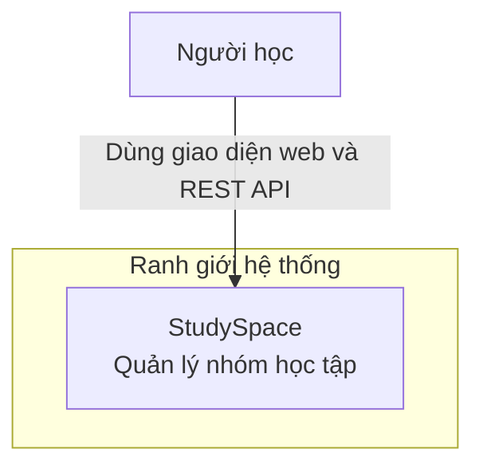
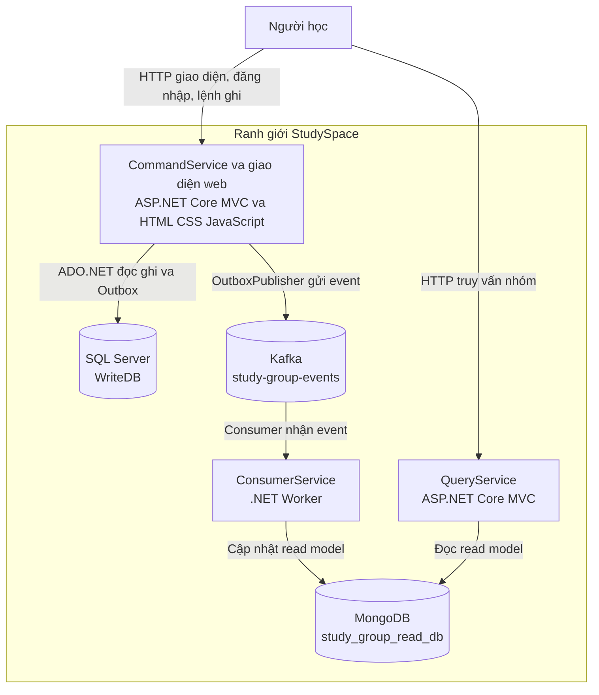
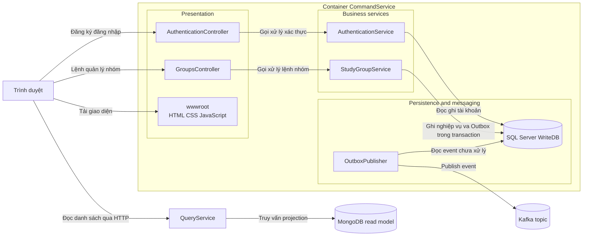

# Giải thích mô hình C4 của StudySpace

Tài liệu này giải thích riêng các sơ đồ C4 của hệ thống quản lý nhóm học tập StudySpace. Các sơ đồ và mô tả dựa trên source hiện tại của Nhóm 9; chúng không mô tả những thành phần chỉ có trong dự án tham khảo.

> README này tập trung vào kiến trúc C4. Hướng dẫn cài đặt, chạy ứng dụng, danh sách API và mô hình dữ liệu chi tiết nằm trong [README.md](README.md).

## 1. C4 là gì?

C4 là cách mô tả kiến trúc phần mềm theo các mức phóng to dần. Tên C4 gợi đến bốn mức thường gặp:

1. **Context**: hệ thống phục vụ ai và nằm trong bối cảnh nào?
2. **Container**: hệ thống được chia thành những ứng dụng, service, tiến trình và kho dữ liệu nào?
3. **Component**: bên trong một container quan trọng có những thành phần phần mềm nào và chúng phối hợp ra sao?
4. **Code**: một component được cài đặt bằng class, interface hoặc cấu trúc mã nào?

Trong tài liệu dự án, ba mức đầu thường đủ để giải thích kiến trúc tổng thể. Mức Code có thể thể hiện bằng class diagram hoặc đọc source; không cần biến sơ đồ C4 thành danh sách tất cả class.

### Cách đọc sơ đồ trong tài liệu này

- Mỗi **hộp** là người dùng, hệ thống, service, tiến trình hoặc kho dữ liệu. Tên công nghệ và nhiệm vụ được ghi ngắn ngay trong hộp; phần giải thích dài đặt bên dưới.
- **Đường nối có mũi tên** chỉ hướng một bên gọi hoặc gửi dữ liệu tới bên kia. Nhãn trên đường nối mô tả mục đích hoặc giao thức.
- **Khung có tên** gom các thành phần thuộc cùng ranh giới, chẳng hạn ranh giới StudySpace hoặc ranh giới một service.
- Sơ đồ Context lược bỏ chi tiết kỹ thuật; sang Container và Component thì lần lượt mở rộng các phần đó.
- Sơ đồ C4 diễn tả cấu trúc và trách nhiệm. Một luồng theo thời gian như “đăng nhập rồi tạo nhóm” phù hợp với sequence diagram hơn.

Các sơ đồ dưới đây dùng Mermaid flowchart với chú thích tiếng Việt để có thể xem trực tiếp trên GitHub và các trình xem Markdown hỗ trợ Mermaid.

## 2. Cấp 1 - System Context

### Câu hỏi cấp Context trả lời

Ở mức này, người đọc cần hiểu StudySpace là hệ thống gì, người nào sử dụng và hệ thống tương tác với ai. Chưa cần biết controller nào nhận request, database tên gì hoặc Kafka hoạt động ra sao.

Trong source hiện tại, tác nhân chính là **người học**. Người học dùng ứng dụng để đăng ký, đăng nhập, tìm nhóm, tạo nhóm, gửi yêu cầu tham gia, duyệt yêu cầu nếu là chủ nhóm, hoặc rời nhóm nếu là thành viên.

<!-- mermaid-checked: no \n, no em-dash/en-dash, no {} in labels, subgraphs are id["label"], arrows are -->|"label"|, all subgraphs closed by end, ids unique -->

### Giải thích từng phần

| Thành phần | Ý nghĩa trong sơ đồ |
|---|---|
| Người học | Người sử dụng hệ thống. Cùng một người có thể tạo nhóm, xin vào nhóm khác hoặc làm thành viên đã được duyệt. |
| StudySpace | Toàn bộ sản phẩm phần mềm đang được mô tả, chưa tách thành các project hoặc tiến trình riêng ở mức này. |
| Mũi tên từ người học đến StudySpace | Người dùng gửi yêu cầu qua giao diện web/API và nhận kết quả từ hệ thống. Đây là quan hệ sử dụng, chưa nêu endpoint cụ thể. |
| Ranh giới hệ thống | Giúp phân biệt phần mềm StudySpace với tác nhân ở ngoài nó. |

### Vì sao Context chưa vẽ SQL Server, MongoDB và Kafka?

Mục tiêu của sơ đồ này là giới thiệu sản phẩm theo góc nhìn người dùng, nên chi tiết hạ tầng được để sang cấp Container. Điều đó không có nghĩa là hệ thống không phụ thuộc các công nghệ này. Ở sơ đồ tiếp theo, SQL Server, MongoDB và Kafka được thể hiện rõ cùng những service sử dụng chúng.

### Khi trình bày

Có thể giới thiệu sơ đồ bằng câu: *“Người học tương tác với một hệ thống StudySpace để quản lý nhóm học tập. Ở mức bối cảnh, chúng ta chỉ quan tâm ai sử dụng hệ thống và mục đích sử dụng; cách triển khai các service sẽ được mở rộng ở cấp Container.”*

## 3. Cấp 2 - Container

### “Container” trong C4 có nghĩa gì?

Container trong C4 **không nhất thiết là Docker container**. Đây là một đơn vị có thể chạy hoặc lưu trữ dữ liệu độc lập ở mức kiến trúc, ví dụ một ứng dụng web, một service API, một worker nền, một cơ sở dữ liệu hoặc một message broker.

Ở StudySpace, các thành phần ứng dụng có thể chạy riêng là:

- **CommandService**: API ghi, xác thực tài khoản và host các file giao diện tĩnh trong `wwwroot`.
- **QueryService**: API đọc read model MongoDB.
- **ConsumerService**: worker nền nhận event Kafka và cập nhật read model.

SQL Server, MongoDB và Kafka là các container hạ tầng dữ liệu/giao tiếp mà những service này sử dụng. Docker Compose hiện cấu hình Kafka cùng ZooKeeper; SQL Server và MongoDB được cài/chạy riêng theo hướng dẫn local.

<!-- mermaid-checked: no \n, no em-dash/en-dash, no {} in labels, subgraphs are id["label"], arrows are -->|"label"|, all subgraphs closed by end, ids unique -->

### Giải thích trách nhiệm và kết nối

| Container | Trách nhiệm | Vì sao tách riêng? |
|---|---|---|
| CommandService và giao diện web | Nhận đăng ký/đăng nhập và lệnh tạo nhóm, gửi yêu cầu tham gia, duyệt/từ chối, xóa hoặc rời nhóm. Cũng phục vụ các file HTML/CSS/JavaScript. | Đây là phía xử lý thay đổi nghiệp vụ. Dữ liệu ghi chính được lưu trong SQL Server. |
| QueryService | Tìm nhóm, lấy chi tiết, tổng hợp các nhóm của tài khoản và đọc yêu cầu chờ xử lý. | Phục vụ thao tác đọc từ MongoDB projection, tách khỏi xử lý lệnh ghi. |
| ConsumerService | Đọc Kafka topic `study-group-events` và áp dụng event vào MongoDB. | Có thể chạy nền mà không nhận request HTTP từ trình duyệt. Project hiện không mở HTTP port. |
| SQL Server `WriteDB` | Lưu `Accounts`, `StudyGroups`, `GroupMembers`, `JoinRequests` và `OutboxMessages`. | Là nguồn dữ liệu chính của đăng nhập và các thao tác ghi. |
| Kafka | Chuyển các event từ OutboxPublisher đến ConsumerService qua topic `study-group-events`. | Các service không cần đợi consumer cập nhật xong mới trả kết quả lệnh. |
| MongoDB `study_group_read_db` | Lưu hai collection `study_groups` và `join_requests`. | Là read model được ConsumerService cập nhật và QueryService truy vấn. |

### Đọc các đường nối quan trọng

1. **Người học → CommandService**: trình duyệt mở UI trên CommandService, gửi đăng nhập và các lệnh thay đổi dữ liệu. Các request cần đăng nhập gửi JWT bearer token.
2. **Người học → QueryService**: UI gọi trực tiếp địa chỉ QueryService để tìm kiếm và đọc dữ liệu. Một số thao tác cá nhân, như lấy nhóm của tôi, cần JWT.
3. **CommandService → SQL Server**: thao tác ghi và bản ghi Outbox được lưu trong transaction SQL. CommandService dùng ADO.NET qua `Microsoft.Data.SqlClient`, không dùng Entity Framework.
4. **CommandService → Kafka → ConsumerService**: OutboxPublisher gửi event; worker nhận và cập nhật read model. Đây là giao tiếp bất đồng bộ.
5. **QueryService → MongoDB**: API đọc lấy dữ liệu đã được chiếu sang read model. QueryService không đọc trực tiếp các bảng SQL để dựng danh sách nhóm.

### Những gì sơ đồ cho biết - và không cho biết

- Sơ đồ cho biết frontend gọi **trực tiếp** hai API service; hiện không có API Gateway.
- Sơ đồ cho biết QueryService và ConsumerService cùng truy cập database `study_group_read_db`, mỗi service có vai trò đọc hoặc cập nhật projection riêng.
- Sơ đồ không có nghĩa là mọi thành phần chạy cùng một tiến trình. Ba project .NET được khởi chạy riêng; Kafka/ZooKeeper chạy bằng Docker Compose; MongoDB và SQL Server là phụ thuộc local.
- Sơ đồ không diễn tả thứ tự theo thời gian hoặc chính sách thử lại. Các chi tiết đó thuộc sequence diagram và phần triển khai.

### Quan hệ giữa sơ đồ Container và CQRS

CQRS tách **lệnh thay đổi dữ liệu** khỏi **truy vấn dữ liệu**. Trong hệ thống hiện tại:

- Nhánh ghi: trình duyệt → CommandService → SQL Server.
- Nhánh đọc: trình duyệt → QueryService → MongoDB.
- Kafka và ConsumerService nối hai nhánh bằng event để cập nhật projection.

Do ConsumerService xử lý sau khi lệnh SQL hoàn tất, phản hồi tạo nhóm có thể đến trước lúc MongoDB nhìn thấy nhóm mới. Đây là tính nhất quán sau cùng (eventual consistency), không phải lỗi kiến trúc tự thân; UI có thể cần làm mới hoặc thông báo trạng thái đồng bộ.

## 4. Cấp 3 - Component bên trong CommandService

### Vì sao phóng to CommandService?

CommandService là nơi xử lý đăng nhập và các lệnh nghiệp vụ, đồng thời chứa cơ chế Outbox để chuyển thay đổi sang Kafka. Sơ đồ cấp Component chỉ phóng to container này để giải thích các thành phần chính bên trong; QueryService, ConsumerService và MongoDB vẫn là các thành phần ngoài phạm vi đang phóng to.

Các component bên dưới tương ứng với class hoặc phần triển khai trong source, gồm `AuthenticationController`, `GroupsController`, `AuthenticationService`, `StudyGroupService` và `OutboxPublisher`.

<!-- mermaid-checked: no \n, no em-dash/en-dash, no {} in labels, subgraphs are id["label"], arrows are -->|"label"|, all subgraphs closed by end, ids unique -->

### Giải thích các component

| Component | Vai trò trong luồng |
|---|---|
| `wwwroot` | Chứa giao diện tĩnh. JavaScript trong trình duyệt gửi request trực tiếp tới CommandService hoặc QueryService. |
| `AuthenticationController` | Nhận request đăng ký, đăng nhập, hoặc lấy tài khoản hiện tại; chuyển xử lý sang `AuthenticationService`. |
| `GroupsController` | Nhận các lệnh tạo nhóm, gửi yêu cầu tham gia, duyệt/từ chối, xóa nhóm và rời nhóm. Controller lấy định danh người dùng từ JWT thay vì tin giá trị do client tự gửi. |
| `AuthenticationService` | Truy cập bảng `Accounts`, chuẩn hóa email, kiểm tra mật khẩu và tạo JWT. Mật khẩu được băm PBKDF2-HMAC-SHA256. |
| `StudyGroupService` | Thực hiện thao tác nghiệp vụ với các bảng nhóm và tạo payload sự kiện tương ứng. |
| SQL Server `WriteDB` | Lưu tài khoản, dữ liệu ghi của nhóm và Outbox. Đây là cơ sở dữ liệu nguồn cho lệnh ghi. |
| `OutboxPublisher` | Đọc message chưa publish từ Outbox, gửi đến Kafka và cập nhật trạng thái xử lý theo logic hiện thực. |
| Kafka topic | Ranh giới giao tiếp sang ConsumerService. CommandService không ghi trực tiếp MongoDB. |
| QueryService và MongoDB | Được vẽ bên ngoài ranh giới CommandService để nhấn mạnh đây là luồng đọc ở container khác; QueryService truy vấn read model do consumer cập nhật. |

### Hai luồng cần phân biệt

**Đăng nhập**:

1. Trình duyệt gửi thông tin đến `AuthenticationController`.
2. Controller gọi `AuthenticationService`.
3. Service tìm tài khoản trong SQL Server theo email chuẩn hóa và xác minh password hash.
4. Service tạo JWT, trả về profile cùng access token.
5. Frontend giữ token trong `sessionStorage` và gửi bearer token cho các API được bảo vệ.

**Tạo nhóm**:

1. Trình duyệt gửi lệnh đến `GroupsController` cùng JWT.
2. Controller xác định chủ nhóm từ các claim đã xác thực.
3. `StudyGroupService` ghi nhóm, bản ghi chủ nhóm và event Outbox trong một transaction SQL.
4. `OutboxPublisher` gửi event sang Kafka.
5. ConsumerService xử lý event, cập nhật MongoDB; QueryService sẽ trả projection khi frontend đọc.

Bước 4-5 xảy ra bất đồng bộ sau khi transaction ghi hoàn tất; sơ đồ Component cho biết các phụ thuộc, còn sequence diagram phù hợp hơn để trình bày rõ thứ tự đó.

## 5. Đối chiếu ba mức C4

| Mức | Phạm vi nhìn | Câu hỏi chính | Ví dụ trong StudySpace |
|---|---|---|---|
| Context | Toàn bộ sản phẩm và người sử dụng | Ai dùng StudySpace và dùng để làm gì? | Người học tương tác với StudySpace |
| Container | Các ứng dụng, service, worker và kho dữ liệu | Hệ thống gồm những đơn vị chạy/lưu trữ nào và chúng kết nối ra sao? | CommandService, QueryService, ConsumerService, SQL Server, Kafka, MongoDB |
| Component | Một container được chọn | Các thành phần chính bên trong container phối hợp thế nào? | Controllers, services, OutboxPublisher và SQL bên trong CommandService |
| Code | Một component hoặc class cụ thể | Cấu trúc mã bên trong một thành phần ra sao? | Có thể xem class/interface liên quan trong project .NET; README này không liệt kê toàn bộ class |

**Quy tắc đọc từ trái sang phải hoặc từ trên xuống dưới:** bắt đầu với người dùng và mục tiêu, tiếp theo xem ranh giới service và dữ liệu, rồi cuối cùng đi vào trách nhiệm của controller/service. Nếu một sơ đồ cấp thấp có quá nhiều chi tiết, hãy quay về cấp cao hơn để giải thích tổng thể.

## 6. Các điểm kiến trúc cần trình bày chính xác

- StudySpace có ba project .NET chính: CommandService, QueryService và ConsumerService.
- CommandService vừa host giao diện tĩnh, vừa cung cấp API ghi/xác thực; QueryService là một API service riêng.
- ConsumerService là worker nền, không có HTTP port trong cấu hình hiện tại.
- Giao diện gọi trực tiếp CommandService và QueryService; không có API Gateway.
- SQL Server là write model; MongoDB là read model; Kafka kết nối cập nhật theo event.
- QueryService và ConsumerService cùng dùng MongoDB database `study_group_read_db`; do đó không nên mô tả là mỗi service có database riêng hoàn toàn.
- Đăng nhập và cấp JWT thực hiện trong CommandService; QueryService xác minh JWT trên các API cần xác thực.
- Dữ liệu đọc có thể trễ so với dữ liệu ghi do luồng cập nhật qua Kafka bất đồng bộ.

## 7. Liên kết đến mã nguồn và tài liệu liên quan

- [README tổng của dự án](README.md)
- [CommandService Program.cs](CommandService/Program.cs)
- [AuthenticationController](CommandService/Controllers/AuthenticationController.cs)
- [GroupsController của CommandService](CommandService/Controllers/GroupsController.cs)
- [AuthenticationService](CommandService/Services/AuthenticationService.cs)
- [StudyGroupService](CommandService/Services/StudyGroupService.cs)
- [OutboxPublisher](CommandService/Services/OutboxPublisher.cs)
- [QueryService Program.cs](QueryService/Program.cs)
- [GroupsController của QueryService](QueryService/Controllers/GroupsController.cs)
- [StudyGroupRepository](QueryService/Repositories/StudyGroupRepository.cs)
- [ConsumerService Worker](ConsumerService/Worker.cs)
- [StudyGroupCreatedHandler](ConsumerService/Handlers/StudyGroupCreatedHandler.cs)
