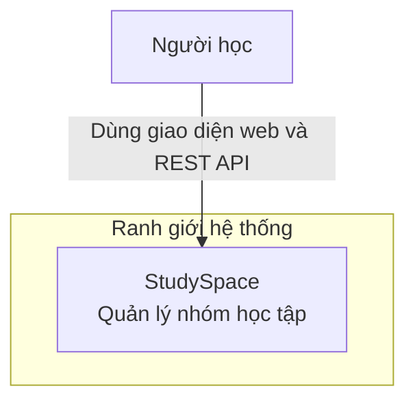
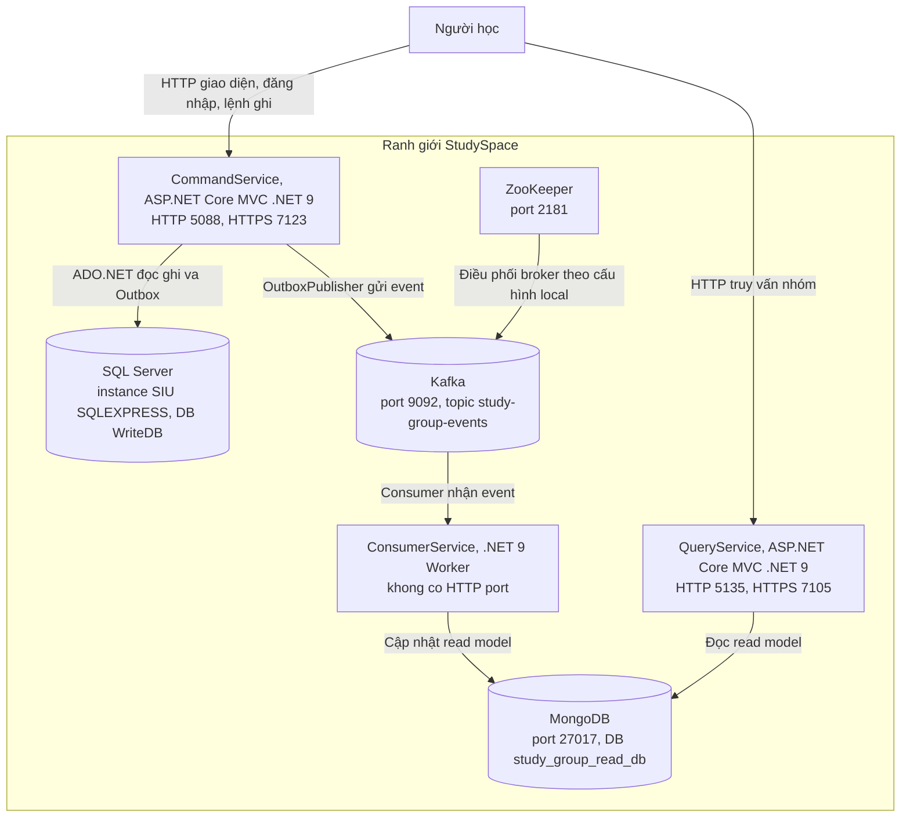
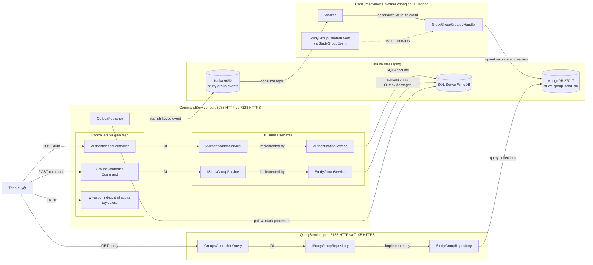
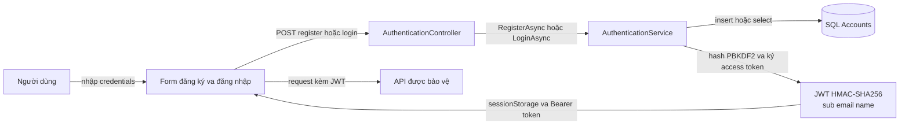
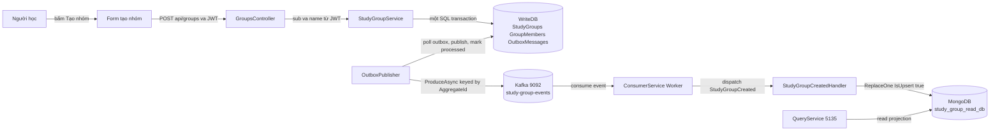

# Giải thích mô hình C4 của StudySpace

Tài liệu này giải thích riêng các sơ đồ C4 **As-Is** của StudySpace theo source hiện tại của Nhóm 9. Thiết kế **To-Be** cho bài mới được tách riêng tại [bộ C4 StudySpace mới](docs/images/c4-studyspace-moi/README.md); không trộn hai kiến trúc vào cùng một mô tả.

> README này tập trung vào kiến trúc C4. Hướng dẫn cài đặt, chạy ứng dụng, danh sách API và mô hình dữ liệu chi tiết nằm trong [README.md](README.md).

## 1. C4 là gì?

C4 là cách mô tả kiến trúc phần mềm theo các mức phóng to dần. Tên C4 gợi đến bốn mức thường gặp:

1. **Context**: hệ thống phục vụ ai và nằm trong bối cảnh nào?
2. **Container**: hệ thống được chia thành những ứng dụng, service, tiến trình và kho dữ liệu nào?
3. **Component**: bên trong một container quan trọng có những thành phần phần mềm nào và chúng phối hợp ra sao?
4. **Code**: một component được cài đặt bằng class, interface hoặc cấu trúc mã nào?

Trong tài liệu dự án, ba mức đầu thường đủ để giải thích kiến trúc tổng thể. Mức Code có thể thể hiện bằng class diagram hoặc đọc source; không cần biến sơ đồ C4 thành danh sách tất cả class.

### Cách đọc sơ đồ trong tài liệu này

- Mỗi **hộp** là người dùng, hệ thống, service, tiến trình hoặc kho dữ liệu. Tên công nghệ và nhiệm vụ được ghi ngắn ngay trong hộp; phần giải thích dài đặt bên dưới.
- **Đường nối có mũi tên** chỉ hướng một bên gọi hoặc gửi dữ liệu tới bên kia. Nhãn trên đường nối mô tả mục đích hoặc giao thức.
- **Khung có tên** gom các thành phần thuộc cùng ranh giới, chẳng hạn ranh giới StudySpace hoặc ranh giới một service.
- Sơ đồ Context lược bỏ chi tiết kỹ thuật; sang Container và Component thì lần lượt mở rộng các phần đó.
- Sơ đồ C4 diễn tả cấu trúc và trách nhiệm. Một luồng theo thời gian như “đăng nhập rồi tạo nhóm” phù hợp với sequence diagram hơn.

Các sơ đồ dưới đây dùng Mermaid flowchart với chú thích tiếng Việt để có thể xem trực tiếp trên GitHub và các trình xem Markdown hỗ trợ Mermaid.

## 2. Cấp 1 - System Context

### Câu hỏi cấp Context trả lời

Ở mức này, người đọc cần hiểu StudySpace là hệ thống gì, người nào sử dụng và hệ thống tương tác với ai. Chưa cần biết controller nào nhận request, database tên gì hoặc Kafka hoạt động ra sao.

Trong source hiện tại, tác nhân chính là **người học**. Người học dùng ứng dụng để đăng ký, đăng nhập, tìm nhóm, tạo nhóm, gửi yêu cầu tham gia, duyệt yêu cầu nếu là chủ nhóm, hoặc rời nhóm nếu là thành viên.
“Chủ nhóm”, “thành viên” và “người xin tham gia” là các vai trò nghiệp vụ của cùng loại tài khoản, không phải ba hệ thống đăng nhập riêng.

<!-- mermaid-checked: no \n, no em-dash/en-dash, no {} in labels, subgraphs are id["label"], arrows are -->|"label"|, all subgraphs closed by end, ids unique -->

### Giải thích từng phần

| Thành phần | Ý nghĩa trong sơ đồ |
|---|---|
| Người học | Người sử dụng hệ thống. Cùng một người có thể tạo nhóm, xin vào nhóm khác hoặc làm thành viên đã được duyệt. |
| StudySpace | Toàn bộ sản phẩm phần mềm đang được mô tả, chưa tách thành các project hoặc tiến trình riêng ở mức này. |
| Mũi tên từ người học đến StudySpace | Người dùng gửi yêu cầu qua giao diện web/API và nhận kết quả từ hệ thống. Đây là quan hệ sử dụng, chưa nêu endpoint cụ thể. |
| Ranh giới hệ thống | Giúp phân biệt phần mềm StudySpace với tác nhân ở ngoài nó. |

### Vì sao Context chưa vẽ SQL Server, MongoDB và Kafka?

Mục tiêu của sơ đồ này là giới thiệu sản phẩm theo góc nhìn người dùng, nên chi tiết hạ tầng được để sang cấp Container. Điều đó không có nghĩa là hệ thống không phụ thuộc các công nghệ này. Ở sơ đồ tiếp theo, SQL Server, MongoDB và Kafka được thể hiện rõ cùng những service sử dụng chúng.

### Khi trình bày

Có thể giới thiệu sơ đồ bằng câu: *“Người học tương tác với một hệ thống StudySpace để quản lý nhóm học tập. Ở mức bối cảnh, chúng ta chỉ quan tâm ai sử dụng hệ thống và mục đích sử dụng; cách triển khai các service sẽ được mở rộng ở cấp Container.”*

## 3. Cấp 2 - Container

### “Container” trong C4 có nghĩa gì?

Container trong C4 **không nhất thiết là Docker container**. Đây là một đơn vị có thể chạy hoặc lưu trữ dữ liệu độc lập ở mức kiến trúc, ví dụ một ứng dụng web, một service API, một worker nền, một cơ sở dữ liệu hoặc một message broker.

Ở StudySpace, các thành phần ứng dụng có thể chạy riêng là:

- **CommandService**: API ghi, xác thực tài khoản và host các file giao diện tĩnh trong `wwwroot`.
- **QueryService**: API đọc read model MongoDB.
- **ConsumerService**: worker nền nhận event Kafka và cập nhật read model.

SQL Server, MongoDB và Kafka là các container hạ tầng dữ liệu/giao tiếp mà những service này sử dụng. Docker Compose hiện cấu hình Kafka cùng ZooKeeper; SQL Server và MongoDB được cài/chạy riêng theo hướng dẫn local.

<!-- mermaid-checked: no \n, no em-dash/en-dash, no {} in labels, subgraphs are id["label"], arrows are -->|"label"|, all subgraphs closed by end, ids unique -->

### Giải thích trách nhiệm và kết nối

| Container | Trách nhiệm | Vì sao tách riêng? |
|---|---|---|
| CommandService và giao diện web | Nhận đăng ký/đăng nhập và lệnh tạo nhóm, gửi yêu cầu tham gia, duyệt/từ chối, xóa hoặc rời nhóm. Cũng phục vụ các file HTML/CSS/JavaScript. | Đây là phía xử lý thay đổi nghiệp vụ. Dữ liệu ghi chính được lưu trong SQL Server. |
| QueryService | Tìm nhóm, lấy chi tiết, tổng hợp các nhóm của tài khoản và đọc yêu cầu chờ xử lý. | Phục vụ thao tác đọc từ MongoDB projection, tách khỏi xử lý lệnh ghi. |
| ConsumerService | Đọc Kafka topic `study-group-events` và áp dụng event vào MongoDB. | Có thể chạy nền mà không nhận request HTTP từ trình duyệt. Project hiện không mở HTTP port. |
| SQL Server `WriteDB` | Lưu `Accounts`, `StudyGroups`, `GroupMembers`, `JoinRequests` và `OutboxMessages`. | Là nguồn dữ liệu chính của đăng nhập và các thao tác ghi. |
| Kafka | Chuyển các event từ OutboxPublisher đến ConsumerService qua topic `study-group-events`; bootstrap server mặc định là `localhost:9092`. | Các service không cần đợi consumer cập nhật xong mới trả kết quả lệnh. |
| ZooKeeper | Coordination service theo cấu hình `confluentinc/cp-zookeeper:7.4.0` trong Docker Compose; cổng `2181`. | Là phụ thuộc của broker Kafka trong cấu hình Compose hiện tại. |
| MongoDB `study_group_read_db` | Lưu hai collection `study_groups` và `join_requests`. | Là read model được ConsumerService cập nhật và QueryService truy vấn. |

### Cổng thực tế trong cấu hình chạy local

| Thành phần | Cổng | Nguồn cấu hình / ghi chú |
|---|---:|---|
| CommandService HTTP | `5088` | `CommandService/Properties/launchSettings.json`, profile `http` |
| CommandService HTTPS | `7123` | Profile `https`; cũng khai báo HTTP `5088` |
| QueryService HTTP | `5135` | `QueryService/Properties/launchSettings.json`, profile `http` |
| QueryService HTTPS | `7105` | Profile `https`; cũng khai báo HTTP `5135` |
| ConsumerService | Không có HTTP port | Worker nền, không dựng WebApplication |
| Kafka | `9092` | `docker-compose.yml`, `Kafka:BootstrapServers` |
| ZooKeeper | `2181` | `docker-compose.yml` |
| MongoDB | `27017` | Connection string `mongodb://localhost:27017/` |
| SQL Server | Không có port cố định trong cấu hình | Connection string dùng instance `SIU\SQLEXPRESS`; cổng thực tế do SQL Server instance cấu hình quyết định |

Khi chạy `python chay_du_an.py`, script kiểm tra .NET, khởi động SQL Server Express và MongoDB Windows services nếu cần, bật Docker Compose, đồng bộ JWT signing key trong user-secrets, rồi chạy ba project. Script không tạo MongoDB container hay SQL Server container; chỉ Kafka và ZooKeeper nằm trong Compose.

### Đọc các đường nối quan trọng

1. **Người học → CommandService**: trình duyệt mở UI trên CommandService, gửi đăng nhập và các lệnh thay đổi dữ liệu. Các request cần đăng nhập gửi JWT bearer token.
2. **Người học → QueryService**: UI gọi trực tiếp địa chỉ QueryService để tìm kiếm và đọc dữ liệu. Một số thao tác cá nhân, như lấy nhóm của tôi, cần JWT.
3. **CommandService → SQL Server**: thao tác ghi và bản ghi Outbox được lưu trong transaction SQL. CommandService dùng ADO.NET qua `Microsoft.Data.SqlClient`, không dùng Entity Framework.
4. **CommandService → Kafka → ConsumerService**: OutboxPublisher gửi event; worker nhận và cập nhật read model. Đây là giao tiếp bất đồng bộ.
5. **QueryService → MongoDB**: API đọc lấy dữ liệu đã được chiếu sang read model. QueryService không đọc trực tiếp các bảng SQL để dựng danh sách nhóm.

### Những gì sơ đồ cho biết - và không cho biết

- Sơ đồ cho biết frontend gọi **trực tiếp** hai API service; hiện không có API Gateway.
- Sơ đồ cho biết QueryService và ConsumerService cùng truy cập database `study_group_read_db`, mỗi service có vai trò đọc hoặc cập nhật projection riêng.
- Sơ đồ không có nghĩa là mọi thành phần chạy cùng một tiến trình. Ba project .NET được khởi chạy riêng; Kafka/ZooKeeper chạy bằng Docker Compose; MongoDB và SQL Server là phụ thuộc local.
- Sơ đồ không diễn tả thứ tự theo thời gian hoặc chính sách thử lại. Các chi tiết đó thuộc sequence diagram và phần triển khai.

### Quan hệ giữa sơ đồ Container và CQRS

CQRS tách **lệnh thay đổi dữ liệu** khỏi **truy vấn dữ liệu**. Trong hệ thống hiện tại:

- Nhánh ghi: trình duyệt → CommandService → SQL Server.
- Nhánh đọc: trình duyệt → QueryService → MongoDB.
- Kafka và ConsumerService nối hai nhánh bằng event để cập nhật projection.

Do ConsumerService xử lý sau khi lệnh SQL hoàn tất, phản hồi tạo nhóm có thể đến trước lúc MongoDB nhìn thấy nhóm mới. Đây là tính nhất quán sau cùng (eventual consistency), không phải lỗi kiến trúc tự thân; UI có thể cần làm mới hoặc thông báo trạng thái đồng bộ.

## 4. Cấp 3 - Components trong ba service

Mức Component mở rộng bên trong các container ứng dụng để nhìn thấy class chịu trách nhiệm cho từng bước. Các ranh giới dưới đây vẫn là ba project chạy riêng; mũi tên nối giữa các khung là giao tiếp xuyên service hoặc đến hạ tầng.

Để giữ đúng cách phân rã C4, các hình dưới đây mở rộng từng container ứng dụng riêng. Component tương ứng với class thực tế như `AuthenticationController`, `StudyGroupService`, `OutboxPublisher`, `Worker`, `StudyGroupCreatedHandler` và `StudyGroupRepository`.

Sơ đồ Mermaid bên dưới là góc nhìn tổng hợp các tương tác xuyên service để tiện theo dõi toàn hệ thống; ba ảnh phía trên mới là các sơ đồ phân rã component theo từng container.

<!-- mermaid-checked: no \n, no em-dash/en-dash, no {} in labels, subgraphs are id["label"], arrows are -->|"label"|, all subgraphs closed by end, ids unique -->

### Giải thích các component

| Component | Vai trò trong luồng |
|---|---|
| `wwwroot/index.html`, `app.js`, `styles.css` | Giao diện tĩnh do CommandService phục vụ. JavaScript gọi Command API tại cùng origin và gọi QueryService trực tiếp theo `queryApi` mặc định `http://localhost:5135`. |
| Command `AuthenticationController` | Nhận `POST /api/auth/register`, `POST /api/auth/login` và `GET /api/auth/me`; chuyển nghiệp vụ sang `IAuthenticationService`. |
| Command `GroupsController` | Nhận lệnh ghi. Dùng claim `sub` làm actor ID và claim `name` làm tên chủ nhóm; không tin owner/user ID do request body gửi lên. |
| `IAuthenticationService` / `AuthenticationService` | Interface và implementation cho khởi tạo bảng tài khoản, đăng ký, đăng nhập, tra cứu profile, băm/xác minh password và phát JWT. |
| `IStudyGroupService` / `StudyGroupService` | Interface và implementation cho tạo/xóa nhóm, xin tham gia, duyệt/từ chối và rời nhóm; dùng SQL transaction và tạo Outbox event. |
| `OutboxPublisher` | `BackgroundService` trong CommandService; poll message chưa xử lý, publish vào Kafka rồi ghi `ProcessedAtUtc`. |
| `Worker` | `BackgroundService` trong ConsumerService; subscribe topic, đọc `EventType`, chọn event DTO/handler, commit offset sau xử lý. |
| `StudyGroupCreatedHandler` | Chuyển event thành MongoDB projection: tạo nhóm, upsert yêu cầu, đổi tên chủ, đổi số thành viên hoặc xóa dữ liệu liên quan. |
| Consumer event models | `StudyGroupCreatedEvent` và `StudyGroupEvent` định nghĩa payload JSON mà Producer và Consumer phải hiểu giống nhau. Các class được khai báo riêng ở hai project. |
| Query `GroupsController` | Expose API tìm kiếm, chi tiết, `/mine` và join requests. Chỉ các route riêng tư được `[Authorize]`. |
| `IStudyGroupRepository` / `StudyGroupRepository` | Interface và MongoDB implementation cho truy vấn nhóm, nhóm của người dùng, join requests và phân trang/tìm kiếm. |
| SQL Server / Kafka / MongoDB | Các hệ thống dữ liệu và message broker nằm ngoài code component của API; được nối vào từng service theo đúng quyền sở hữu ở mức container. |

### Vòng đời vận hành tổng quát

Phần này mô tả **cách bản hiện tại trong source chạy**, từ lúc khởi động đến khi dữ liệu đọc được cập nhật. Nó không phải kiến trúc To-Be ở thư mục sơ đồ dành cho bài mới.

#### Khi khởi động

1. Người dùng chạy `python chay_du_an.py`. Script kiểm tra .NET 9, sau đó đảm bảo các Windows service SQL Server Express và MongoDB đang chạy.
2. Script khởi động Docker Desktop nếu cần, chạy `docker compose up -d` cho Kafka và ZooKeeper, rồi chờ Kafka mở cổng `9092`.
3. Script kiểm tra và đồng bộ JWT signing key trong .NET user-secrets giữa CommandService và QueryService.
4. Script chạy CommandService tại `http://localhost:5088`, QueryService tại `http://localhost:5135`, và ConsumerService dưới dạng worker nền không có HTTP port.
5. Script đợi các API phản hồi qua URL/Swagger và kiểm tra worker chưa thoát, sau đó mở giao diện. Khi nhấn Ctrl+C, script dừng ba tiến trình .NET; SQL Server, MongoDB và Kafka vẫn tiếp tục chạy.

#### Khi người dùng sử dụng ứng dụng

1. Trình duyệt tải giao diện tĩnh `wwwroot` từ CommandService. Giao diện gửi đăng ký, đăng nhập và lệnh ghi về CommandService; các truy vấn được gọi trực tiếp tới QueryService.
2. Sau khi đăng nhập, trình duyệt gửi JWT trong header `Authorization: Bearer`. Hai API xác thực chữ ký, issuer, audience và thời hạn. CommandService lấy người dùng từ claim `sub`, không dựa vào ID người dùng do client tự gửi.
3. CommandService xử lý thay đổi nghiệp vụ trong SQL Server. Với các thao tác cần phát sự kiện, dữ liệu nghiệp vụ và Outbox được ghi trong cùng SQL transaction.
4. CommandService có thể trả kết quả sau khi SQL commit, không đợi MongoDB cập nhật. `OutboxPublisher` đọc message chưa xử lý, gửi lên Kafka topic `study-group-events` với `AggregateId` làm key, rồi đánh dấu message đã xử lý.
5. ConsumerService đọc topic, gọi handler để cập nhật projection trong MongoDB, rồi mới commit Kafka offset. Nếu xử lý lỗi, worker seek về message đó và thử lại; QueryService đọc dữ liệu từ projection này.

Vì vậy, **SQL Server là nguồn dữ liệu ghi**, còn MongoDB là read model cập nhật bất đồng bộ. Có thể có một khoảng trễ giữa lúc lệnh ghi thành công và lúc truy vấn thấy thay đổi. Outbox giúp không bỏ quên event khi Kafka tạm thời lỗi, nhưng không bảo đảm exactly-once: nếu publisher dừng sau khi publish nhưng trước khi đánh dấu Outbox, message có thể được phát lại.

Trong nghiệp vụ duyệt thành viên, kiểm tra sức chứa và thêm member được quyết định trong SQL dưới khóa giao dịch; `Pending` không giữ chỗ. Chi tiết khóa `UPDLOCK, HOLDLOCK` và luồng duyệt nằm ở mục 5.3.

## 5. Ba luồng nghiệp vụ end-to-end

Các luồng sau nối giao diện, API, dữ liệu và message broker. Chúng bổ sung cho sơ đồ C4: C4 nói thành phần nào kết nối với nhau; sequence diagram cho biết thứ tự xử lý một nghiệp vụ.

### 5.1 Đăng ký, đăng nhập và xác thực JWT

#### Đăng ký

1. Người dùng bấm tab **Tạo tài khoản**, điền tên hiển thị, email và mật khẩu rồi gửi form. Ràng buộc trên `RegisterRequest` yêu cầu tên 2-100 ký tự, email hợp lệ và mật khẩu 8-128 ký tự.
2. `app.js` gửi `POST /api/auth/register` tới origin của giao diện, tức CommandService. Không có API Gateway đứng giữa.
3. `AuthenticationController` gọi `IAuthenticationService.RegisterAsync`.
4. `AuthenticationService` trim tên/email, chuẩn hóa email bằng `Trim().ToUpperInvariant()`, sinh GUID tài khoản và băm mật khẩu bằng PBKDF2-HMAC-SHA256: salt ngẫu nhiên 16 byte, 310.000 vòng lặp, hash 32 byte.
5. Service chèn tài khoản vào `dbo.Accounts`. Unique index `UX_Accounts_EmailNormalized` ngăn email đã đăng ký; SQL duplicate được ánh xạ thành lỗi email trùng và API trả `409 Conflict`.
6. Sau khi lưu thành công, service tạo JWT và response gồm access token, kiểu `Bearer`, thời điểm hết hạn và profile. Giao diện đăng ký tự đăng nhập bằng response này, không cần gửi thêm lần login.

#### Đăng nhập

1. Người dùng gửi email và mật khẩu qua `POST /api/auth/login`.
2. `AuthenticationService` tìm tài khoản theo email đã chuẩn hóa, lấy `PasswordHash`, tính lại hash từ mật khẩu nhập và salt đã lưu.
3. Hai hash được so sánh bằng `CryptographicOperations.FixedTimeEquals`; không có mật khẩu rõ được lưu hoặc trả về.
4. Nếu thành công, service cấp JWT mới. Nếu email không tồn tại hoặc mật khẩu sai, controller trả `401 Unauthorized` với thông báo chung.

#### JWT chứa gì và claim `sub` dùng để làm gì?

JWT được ký bằng HMAC-SHA256 với signing key dùng chung giữa CommandService và QueryService. Code tạo các claim:

| Claim / trường | Giá trị và công dụng |
|---|---|
| `sub` | GUID `Account.Id`; là định danh ổn định của tài khoản hiện tại. Command controller dùng claim này để xác định actor, Query controller dùng để lọc dữ liệu cá nhân. |
| `email` | Email của tài khoản. |
| `name` | Tên hiển thị; khi tạo nhóm, CommandService dùng claim này làm `OwnerDisplayName`. |
| `iss`, `aud` | Issuer và audience lấy từ cấu hình `Authentication`. |
| `nbf`, `exp` | Thời điểm bắt đầu hiệu lực và hết hạn token. Mặc định token có thời hạn 60 phút; cấu hình giới hạn 5-1440 phút. |

Hai API xác thực chữ ký, issuer, audience và thời hạn; cấu hình clock skew là 30 giây. `MapInboundClaims = false` giúp code đọc đúng claim tên `sub`, thay vì claim bị ánh xạ sang một tên khác. Signing key phải giống nhau ở hai service, tối thiểu 32 byte và được cấp qua user-secrets hoặc cấu hình môi trường, không commit vào source.

Sau khi nhận token, `app.js` lưu token và profile trong `sessionStorage`, rồi thêm `Authorization: Bearer ...` vào request. `/api/auth/me` xác minh token, parse `sub` thành GUID và tải profile hiện tại từ SQL Server. Token của tài khoản demo không có role toàn cục; quyền **Owner/Member** được kiểm tra dựa trên dữ liệu thành viên của từng nhóm.

<!-- mermaid-checked: no \n, no em-dash/en-dash, no {} in labels, subgraphs are id["label"], arrows are -->|"label"|, all subgraphs closed by end, ids unique -->

### 5.2 Tạo nhóm, Transactional Outbox và MongoDB

1. Người dùng đăng nhập, mở **Tạo nhóm**, điền tên, môn học, mục tiêu, mô tả, lịch, hình thức, địa điểm, trình độ và sĩ số rồi bấm tạo.
2. `app.js` gửi `POST /api/groups` cùng JSON và JWT tới CommandService.
3. `GroupsController` lấy GUID từ claim `sub` và tên từ claim `name`. Client không được tự chọn `OwnerId`.
4. `StudyGroupService.CreateAsync` tạo nhóm với GUID mới, `Active` và thời điểm UTC; trong cùng transaction SQL nó:
   - insert vào `StudyGroups`;
   - insert chủ nhóm vào `GroupMembers` với role `Owner` (nên sĩ số ban đầu là 1);
   - serialize event `StudyGroupCreated` và insert payload vào `OutboxMessages`.
5. Chỉ khi cả ba thao tác thành công, SQL transaction mới commit. Nếu một thao tác thất bại, code rollback cả transaction, tránh có nhóm được ghi mà thiếu owner hoặc event Outbox.
6. API trả `201 Created` sau khi commit SQL. Response này **không chờ** Kafka hay MongoDB.
7. Hosted service `OutboxPublisher` trong CommandService liên tục tìm message chưa xử lý cũ nhất. Khi queue rỗng, nó nghỉ 1 giây.
8. Publisher gửi payload lên topic `study-group-events`, dùng `AggregateId` (GUID nhóm) làm Kafka key; sau khi `ProduceAsync` thành công mới cập nhật `ProcessedAtUtc` trong SQL.
9. `ConsumerService.Worker` subscribe topic với group ID `read-model-consumer`, `EnableAutoCommit = false`, và `AutoOffsetReset = Earliest`. Worker đọc `EventType`, deserialize DTO phù hợp và gọi `StudyGroupCreatedHandler`.
10. Handler thay thế hoặc tạo document nhóm trong `study_groups` bằng `ReplaceOne` với `IsUpsert = true`, thiết lập `MemberCount = 1`, rồi Worker commit Kafka offset sau khi handler hoàn tất.
11. `QueryService` đọc collection MongoDB `study_group_read_db.study_groups`. Giao diện có thể cần tải lại sau khi projection đã được cập nhật.

**Transactional Outbox đảm bảo điều gì?** SQL ghi dữ liệu nhóm và event cần phát trong cùng database transaction. Nếu Kafka tạm thời ngừng sau khi SQL commit, event vẫn còn trong Outbox để publisher thử lại. Outbox không tạo transaction phân tán giữa SQL và Kafka, và code hiện tại không cam kết exactly-once.

**Tại sao dùng Upsert?** Khi event tạo nhóm được xử lý lần đầu, document chưa có nên được insert; khi consumer xử lý lại cùng ID, thao tác replace tránh tạo thêm document cùng `_id`. Tuy nhiên, upsert này không phải bảo đảm idempotency hoàn hảo: event tạo nhóm đang thay toàn bộ document với `MemberCount = 1`. Nếu một bản tạo cũ bị publish lại sau event duyệt thành viên, projection có nguy cơ bị lùi dữ liệu. Có thể cải thiện bằng event version/sequence, dedup `EventId`, hoặc handler tạo nhóm không ghi đè projection mới hơn.

### Event được phát trong vòng đời nhóm

| `EventType` | Phát sinh khi | Consumer cập nhật |
|---|---|---|
| `StudyGroupCreated` | Tạo nhóm | Upsert document nhóm; projection bắt đầu với `MemberCount = 1` vì chủ nhóm đã là member. |
| `StudyGroupOwnerUpdated` | CommandService backfill tên chủ nhóm cho dữ liệu cũ lúc startup | Cập nhật `OwnerDisplayName` trong document nhóm. |
| `JoinRequested` | Người học gửi yêu cầu | Upsert document trong `join_requests`. |
| `JoinRequestApproved` | Chủ nhóm duyệt | Upsert request đã duyệt và set `MemberCount` của nhóm theo số đếm gửi từ SQL. |
| `JoinRequestRejected` | Chủ nhóm từ chối | Upsert request với trạng thái bị từ chối; sĩ số không đổi. |
| `MemberLeft` | Thành viên rời nhóm | Đổi request đã duyệt của user sang `Cancelled` và set lại số member trong projection nhóm. |
| `GroupDeleted` | Chủ nhóm xóa nhóm vĩnh viễn | Xóa document nhóm và tất cả join request của nhóm khỏi MongoDB. Trong SQL, transaction xóa các event Outbox cũ của nhóm và giữ lại event xóa để không phát lại dữ liệu đã xóa. |

<!-- mermaid-checked: no \n, no em-dash/en-dash, no {} in labels, subgraphs are id["label"], arrows are -->|"label"|, all subgraphs closed by end, ids unique -->

### 5.3 Xin tham gia và chủ nhóm duyệt yêu cầu

#### Người học gửi yêu cầu

1. Người dùng bấm **Gửi yêu cầu tham gia**, nhập lời nhắn rồi gửi form; JavaScript gọi `POST /api/groups/{groupId}/join-requests` kèm JWT.
2. `GroupsController` lấy `UserId` từ claim `sub` rồi gọi `StudyGroupService.CreateJoinRequestAsync`.
3. Service mở SQL transaction và gọi `GetGroupForUpdateAsync`, câu SQL đọc nhóm có hint `WITH (UPDLOCK, HOLDLOCK)`.
4. Service kiểm tra nhóm còn `Active`, người gửi chưa là member, chưa có request `Pending`, và số member hiện tại nhỏ hơn `MaxMembers`.
5. Nếu hợp lệ, service insert `JoinRequests` ở trạng thái `Pending` và insert event `JoinRequested` vào Outbox trong cùng transaction rồi commit. Unique filtered index trên `(GroupId, UserId)` với status `Pending` là lớp bảo vệ bổ sung cho request trùng.
6. Publisher phát `JoinRequested`; consumer upsert document yêu cầu vào `join_requests`.

#### Chủ nhóm duyệt

1. Chủ nhóm mở khu vực yêu cầu chờ duyệt. Frontend gọi QueryService `GET /api/groups/{groupId}/join-requests?status=Pending` kèm JWT.
2. QueryService đọc nhóm projection và so sánh `OwnerId` với claim `sub`; không đúng chủ nhóm thì trả `403 Forbidden`.
3. Khi chủ nhóm bấm **Duyệt**, trình duyệt gọi CommandService `POST /api/groups/{groupId}/join-requests/{requestId}/approve` kèm JWT.
4. `StudyGroupService.ReviewJoinRequestAsync` bắt đầu transaction; khóa dòng nhóm bằng `UPDLOCK, HOLDLOCK`, xác nhận người gọi là owner, rồi khóa request cần duyệt bằng cùng hai hint.
5. Service xác nhận request còn `Pending`, nhóm còn `Active`, user chưa là member, sau đó đếm `GroupMembers`. Nếu `memberCount >= MaxMembers`, request không được duyệt và transaction không thêm thành viên.
6. Nếu còn chỗ, service insert thành viên role `Member`, đổi request sang `Approved`, ghi người duyệt/thời điểm duyệt, đếm lại member sau khi insert, rồi ghi event `JoinRequestApproved` chứa `MemberCount` mới vào Outbox. Cả membership, request và event commit trong cùng SQL transaction.
7. Khi chủ nhóm chọn **Từ chối**, service vẫn xác minh owner và trạng thái request dưới transaction/lock; đổi status sang `Rejected`, không thêm member, và ghi event `JoinRequestRejected`.
8. Publisher đưa event sang Kafka. Consumer cập nhật document yêu cầu; với event `JoinRequestApproved`, handler **set** `MemberCount` của nhóm theo con số do SQL gửi trong event, không tăng bằng phép `+1`.
9. Sau khi consumer cập nhật MongoDB, `GET` của QueryService trả trạng thái request và số thành viên mới.

#### Khóa giao dịch chống vượt sĩ số

`GetGroupForUpdateAsync` chạy `SELECT ... FROM dbo.StudyGroups WITH (UPDLOCK, HOLDLOCK) WHERE Id = @GroupId` **bên trong cùng transaction**. `UPDLOCK` yêu cầu update lock trên dòng nhóm; `HOLDLOCK` giữ lock đến khi transaction kết thúc và áp dụng semantics kiểu serializable cho truy vấn đó. Hai lần duyệt đồng thời cho cùng nhóm vì thế không thể cùng đọc một số chỗ trống rồi cùng thêm member: thao tác sau phải chờ transaction trước commit/rollback, sau đó đếm lại `GroupMembers`.

`CreateJoinRequestAsync` cũng khóa dòng nhóm, nên nó tuần tự hóa với các quyết định duyệt/yêu cầu mới trên cùng group. `GetJoinRequestForUpdateAsync` khóa bản ghi request để ngăn cùng request bị xử lý đồng thời. DB còn có unique constraint `(GroupId, UserId)` cho membership. `MemberCount` không phải cột SQL; số chuẩn được tính từ các dòng `GroupMembers`, còn MongoDB lưu bản sao projection để phục vụ truy vấn nhanh.

Lời mời `Pending` không giữ chỗ thành viên. Nhiều yêu cầu có thể chờ khi nhóm còn chỗ; lúc duyệt, service kiểm tra lại số member dưới khóa nên không vượt `MaxMembers`.

```mermaid
flowchart LR
  flowJoinMember["Người xin tham gia"]
  flowJoinUI["Thẻ nhóm va form yêu cầu"]
  flowJoinController["Command GroupsController"]
  flowJoinService["StudyGroupService"]
  flowJoinSql[("SQL transaction<br/>StudyGroups JoinRequests GroupMembers Outbox")]
  flowJoinPublisher["OutboxPublisher"]
  flowJoinKafka[("Kafka<br/>study-group-events")]
  flowJoinWorker["ConsumerService Worker"]
  flowJoinHandler["StudyGroupCreatedHandler"]
  flowJoinMongo[("MongoDB<br/>join_requests va study_groups")]
  flowJoinOwner["Chủ nhóm"]
  flowJoinQueryController["Query GroupsController"]
  flowJoinRepository["StudyGroupRepository"]
  flowJoinMember -->|"POST join-requests"| flowJoinController
  flowJoinController -->|"tạo request Pending"| flowJoinService
  flowJoinService -->|"UPDLOCK HOLDLOCK, ghi request va outbox"| flowJoinSql
  flowJoinSql -->|"publisher poll OutboxMessages"| flowJoinPublisher
  flowJoinPublisher -->|"publish JoinRequested"| flowJoinKafka
  flowJoinKafka -->|"consume"| flowJoinWorker
  flowJoinWorker -->|"dispatch event"| flowJoinHandler
  flowJoinHandler -->|"upsert request"| flowJoinMongo
  flowJoinOwner -->|"GET requests kèm JWT"| flowJoinQueryController
  flowJoinQueryController -->|"ủy quyền owner va query"| flowJoinRepository
  flowJoinRepository -->|"đọc projection"| flowJoinMongo
  flowJoinOwner -->|"POST approve hoặc reject"| flowJoinController
  flowJoinService -->|"serialize cập nhật cùng group row lock"| flowJoinSql
  flowJoinPublisher -->|"publish event mang MemberCount mới"| flowJoinKafka
  flowJoinHandler -->|"set MemberCount projection"| flowJoinMongo
```

<!-- mermaid-checked: no \n, no em-dash/en-dash, no {} in labels, subgraphs are id["label"], arrows are -->|"label"|, all subgraphs closed by end, ids unique -->

## 6. Đối chiếu ba mức C4

| Mức | Phạm vi nhìn | Câu hỏi chính | Ví dụ trong StudySpace |
|---|---|---|---|
| Context | Toàn bộ sản phẩm và người sử dụng | Ai dùng StudySpace và dùng để làm gì? | Người học tương tác với StudySpace |
| Container | Các ứng dụng, service, worker và kho dữ liệu | Hệ thống gồm những đơn vị chạy/lưu trữ nào và chúng kết nối ra sao? | CommandService, QueryService, ConsumerService, SQL Server, Kafka, MongoDB |
| Component | Các component bên trong từng container | Các class chính bên trong service phối hợp thế nào? | Controllers, services, Worker, Handler, Repository và OutboxPublisher |
| Code | Một component hoặc class cụ thể | Cấu trúc mã bên trong một thành phần ra sao? | Có thể xem class/interface liên quan trong project .NET; README này không liệt kê toàn bộ class |

**Quy tắc đọc từ trái sang phải hoặc từ trên xuống dưới:** bắt đầu với người dùng và mục tiêu, tiếp theo xem ranh giới service và dữ liệu, rồi cuối cùng đi vào trách nhiệm của controller/service. Nếu một sơ đồ cấp thấp có quá nhiều chi tiết, hãy quay về cấp cao hơn để giải thích tổng thể.

## 7. Câu hỏi vấn đáp bắt bẻ và câu trả lời gợi ý

### Câu hỏi về mô hình C4 và cách chia service

**1. Vì sao gọi là C4 nhưng tài liệu chỉ có ba sơ đồ?**

C4 có các mức Context, Container, Component và Code. Tài liệu này trình bày ba mức kiến trúc; mức Code nên tập trung vào class/chi tiết cài đặt cần thiết thay vì một sơ đồ khổng lồ liệt kê toàn bộ source.

**2. Container trong C4 có đồng nghĩa với container Docker không?**

Không. Trong C4, container là một đơn vị ứng dụng chạy độc lập hoặc một kho dữ liệu. CommandService, QueryService, ConsumerService, SQL Server, MongoDB và Kafka đều có thể được biểu diễn ở cấp này, dù chỉ Kafka/ZooKeeper được khai báo trong Docker Compose hiện tại.

**3. Tại sao tách CommandService, QueryService và ConsumerService?**

CommandService xử lý ghi và xác thực; QueryService chuyên đọc projection; ConsumerService xử lý event nền. Tách như vậy minh họa CQRS và Event-Driven, nhưng đồng thời tăng số tiến trình, cấu hình và phụ thuộc phải vận hành.

**4. Có thật mỗi service sở hữu một database riêng không?**

Không hoàn toàn. CommandService sở hữu write database SQL Server `WriteDB`. QueryService và ConsumerService cùng truy cập MongoDB database `study_group_read_db`: consumer cập nhật collection, query service đọc collection. Vì vậy không nên khẳng định mô hình Database-per-Service triệt để.

**5. Tại sao không có API Gateway?**

Đây là demo học tập quy mô nhỏ: giao diện chạy trên CommandService nhưng gọi QueryService trực tiếp qua URL cấu hình và CORS. Gateway là phần chưa triển khai, không phải một service ẩn. Với production có thể thêm Gateway để gom endpoint, routing, rate limit, policy bảo mật và TLS tập trung.

**6. Đây có phải CQRS “đầy đủ” với framework/mediator riêng không?**

Không dùng framework CQRS hay command bus. Dự án hiện thực sự tách API ghi/SQL khỏi API đọc/MongoDB và đồng bộ bằng event. Đây là CQRS ở kiến trúc ứng dụng, triển khai gọn theo Controller/Service/Repository.

### Câu hỏi về độ tin cậy và đồng bộ dữ liệu

**7. Transactional Outbox giải quyết vấn đề gì?**

Nó ghi thay đổi nghiệp vụ và event cần phát vào cùng transaction SQL. Nếu commit thành công mà Kafka tạm thời không truy cập được, event vẫn chờ trong `OutboxMessages` để publisher thử gửi lại; không mất dấu event chỉ vì broker ngắt quãng.

**8. Nếu tắt Kafka thì tạo nhóm có thành công không?**

Nếu SQL Server còn hoạt động, lệnh vẫn có thể commit nhóm và event vào Outbox rồi trả response. `OutboxPublisher` ghi lỗi và thử lại sau 3 giây. MongoDB read model sẽ chưa nhận cập nhật cho tới khi Kafka/consumer hoạt động lại. Không được nhầm response `201` với việc projection đã đồng bộ xong.

**9. Nếu SQL Server tắt thì sao?**

CommandService cần SQL để khởi tạo các bảng khi startup và xử lý tài khoản/lệnh ghi. Khi SQL không truy cập được, startup hoặc request liên quan sẽ thất bại; Kafka không thay thế SQL write model.

**10. Nếu MongoDB tắt thì sao?**

QueryService không đọc được danh sách; ConsumerService sẽ không thể hoàn tất cập nhật projection, vì vậy không commit offset cho message lỗi và sẽ seek/thử lại sau 2 giây. Nếu SQL và Kafka vẫn chạy, các thay đổi mới vẫn có thể nằm trong Outbox/topic trong thời gian chờ.

**11. Hệ thống có bảo đảm exactly-once không?**

Không. Outbox publisher publish Kafka trước rồi mới đánh dấu processed trong SQL; nếu process chết giữa hai bước, message có thể được phát lại. Consumer cập nhật Mongo trước rồi mới commit offset; nếu chết sau cập nhật Mongo nhưng trước commit, event có thể được tiêu thụ lần nữa. Cơ chế hiện tại là xử lý có thể lặp lại, không phải exactly-once xuyên SQL, Kafka và Mongo.

**12. Tại sao dùng Upsert trên MongoDB?**

`ReplaceOne(... IsUpsert = true)` giúp event tạo nhóm/yêu cầu có thể tạo document nếu chưa có hoặc cập nhật document theo ID nếu đã có, tránh sinh thêm document trùng ID khi message được phát lại. Nhưng nó không tự xử lý mọi thứ tự phát lại: event tạo nhóm thay toàn bộ projection và đặt `MemberCount = 1`, nên có thể ghi đè projection mới hơn nếu replay xảy ra muộn. Cần dedup/version nếu muốn bảo đảm mạnh hơn.

**13. Vì sao API báo tạo thành công nhưng tìm kiếm chưa thấy nhóm?**

API trả sau khi transaction SQL commit; publisher và consumer chạy bất đồng bộ. MongoDB là read model cập nhật sau, nên có khoảng trễ eventual consistency. Frontend đợi 1,2 giây trước khi tải lại danh sách để cải thiện trải nghiệm, nhưng khoảng đợi đó không phải cam kết đồng bộ.

**14. Kafka key được đặt như thế nào và để làm gì?**

OutboxPublisher dùng GUID `AggregateId` của nhóm làm message key. Các event cùng nhóm được gửi với cùng key, giúp Kafka đưa chúng cùng partition theo partitioner mặc định và duy trì thứ tự trong partition. Điều này không deduplicate message và không thay thế kiểm tra trạng thái trong transaction SQL.

**15. Vì sao Consumer chỉ commit offset sau khi xử lý xong?**

Để không đánh dấu message đã xử lý khi MongoDB handler chưa thành công. Nếu handler lỗi, Worker log, seek về offset lỗi, chờ 2 giây và thử lại. Đổi lại, message độc có thể gây retry lặp; hiện không có dead-letter topic để cô lập message đó.

**16. Worker nhận một event type không hỗ trợ thì chuyện gì xảy ra?**

Worker ghi warning rồi commit offset cho message đó; không retry event không hỗ trợ. Vì vậy phải giữ Producer và Consumer đồng bộ contract/event type. Nếu cần quản trị message lỗi lâu dài thì nên thêm versioning và dead-letter topic.

### Câu hỏi về đăng nhập, sĩ số và dữ liệu

**17. Claim `sub` là gì, sao không gửi `UserId` trong body?**

`sub` là subject, được tạo từ GUID tài khoản lúc CommandService ký JWT. API xác minh chữ ký rồi lấy `sub` làm danh tính; nếu tin UserId từ body, client có thể giả mạo hành động của tài khoản khác. Tên hiển thị `name` cũng lấy từ token đã ký.

**18. Hệ thống dùng role `Admin/User` trong JWT không?**

Không. Token hiện có `sub`, `email`, `name`; quyền nhóm được kiểm tra theo `OwnerId` và `GroupMembers.Role` trong dữ liệu nhóm. Chủ nhóm là vai trò theo từng nhóm, không phải role toàn cục.

**19. Làm sao ngăn hai người được duyệt cùng lúc vượt sĩ số?**

Trong transaction, service khóa dòng StudyGroups bằng `UPDLOCK, HOLDLOCK`, đếm thành viên, kiểm tra `MaxMembers`, rồi insert thành viên và event trước commit. Transaction duyệt thứ hai cho cùng nhóm phải đợi transaction đầu xong rồi mới đếm lại. Ngoài ra còn unique constraint `(GroupId, UserId)` cho membership.

**20. Pending request có giữ trước một chỗ không?**

Không. Request chỉ là trạng thái `Pending`; nó không tạo dòng trong `GroupMembers` và không được cộng vào sĩ số. Mỗi lần duyệt, service kiểm tra lại số member dưới khóa nên chỉ những người thực sự được duyệt mới chiếm chỗ.

**21. `MemberCount` được lưu ở đâu, có phải nguồn sự thật không?**

Nguồn sự thật là số dòng trong SQL `GroupMembers`. Event chứa con số vừa tính trong transaction; ConsumerService set giá trị đó vào trường `MemberCount` trên Mongo projection để truy vấn nhanh. Mongo là bản chiếu, không phải nơi quyết định quyền duyệt thành viên.

**22. Mật khẩu được bảo vệ như thế nào?**

Không lưu mật khẩu rõ. Source dùng PBKDF2-HMAC-SHA256 với salt ngẫu nhiên 16 byte, 310.000 iterations và hash 32 byte; so sánh constant-time. JWT dùng HMAC-SHA256 với signing key tối thiểu 32 byte.

### Câu hỏi về vận hành và phạm vi demo

**23. Docker Compose có chạy toàn bộ cơ sở dữ liệu không?**

Không. Compose hiện chỉ khai báo Kafka và ZooKeeper. Script Python yêu cầu SQL Server Express và MongoDB Windows services chạy local; script khởi động Compose rồi chạy ba project .NET.

**24. Có health check hoặc monitoring endpoint riêng không?**

Không thấy endpoint health, metrics exporter hay tracing endpoint được cấu hình trong controllers/program. `chay_du_an.py` kiểm tra port/Swagger để nhận biết một số service đã sẵn sàng; đó là logic launcher, không phải health API của ứng dụng.

**25. Dự án có integration test tự động cho các luồng này không?**

Trong solution hiện không có project test riêng; có file request `.http` để gọi API thủ công. Các kịch bản concurrency, retry Kafka và eventual consistency nên được bổ sung thành integration tests nếu phát triển tiếp.

**26. Có thể chạy nhiều OutboxPublisher instance để scale ngang không?**

Chưa nên bật nhiều instance như hiện tại. Publisher truy vấn `TOP (1)` message chưa xử lý nhưng chưa claim/lock message trong lúc publish; hai instance có thể cùng đọc và phát một event. Cần cơ chế claim/lease hoặc khóa/đánh dấu đang xử lý trước khi chạy nhiều publisher.

**27. Chỗ nào cần cải thiện trước khi gọi là production-ready?**

Kafka local plaintext; token nằm trong `sessionStorage`; chưa có refresh token, login throttling, dead-letter, event version/dedup, health/metrics/tracing và test tự động. Cần bổ sung các kiểm soát này, quản lý secret/TLS, giám sát backlog và kiểm thử tải/concurrency.

## 8. Các điểm kiến trúc cần trình bày chính xác

- StudySpace có ba project .NET chính: CommandService, QueryService và ConsumerService.
- CommandService vừa host giao diện tĩnh, vừa cung cấp API ghi/xác thực; QueryService là một API service riêng.
- ConsumerService là worker nền, không có HTTP port trong cấu hình hiện tại.
- Giao diện gọi trực tiếp CommandService và QueryService; không có API Gateway.
- SQL Server là write model; MongoDB là read model; Kafka kết nối cập nhật theo event.
- QueryService và ConsumerService cùng dùng MongoDB database `study_group_read_db`; do đó không nên mô tả là mỗi service có database riêng hoàn toàn.
- Đăng nhập và cấp JWT thực hiện trong CommandService; QueryService xác minh JWT trên các API cần xác thực.
- Dữ liệu đọc có thể trễ so với dữ liệu ghi do luồng cập nhật qua Kafka bất đồng bộ.

## 9. Liên kết đến mã nguồn và tài liệu liên quan

### CommandService

| Class/file | Vai trò |
|---|---|
| [CommandService/Program.cs](CommandService/Program.cs) | Đăng ký controllers, JSON enum, JWT bearer validation, DI service và OutboxPublisher; khởi tạo các bảng SQL; host Swagger và file tĩnh. |
| [AuthenticationController.cs](CommandService/Controllers/AuthenticationController.cs) | Endpoint register, login, me; ánh xạ kết quả xác thực sang HTTP. |
| [AuthenticationService.cs](CommandService/Services/AuthenticationService.cs) | Truy cập `Accounts`, chuẩn hóa email, PBKDF2 hash, xác minh password và ký JWT. |
| [IAuthenticationService.cs](CommandService/Services/IAuthenticationService.cs) | Hợp đồng nghiệp vụ mà controller dùng cho đăng ký, đăng nhập, tra profile và khởi tạo database. |
| [GroupsController.cs](CommandService/Controllers/GroupsController.cs) | Endpoint command cho nhóm và join request; lấy actor từ claim `sub`, xử lý authorization/error status. |
| [StudyGroupService.cs](CommandService/Services/StudyGroupService.cs) | DDL khởi tạo bảng; transaction cho create, delete, leave, request và review; chặn sĩ số; ghi Outbox payload. |
| [IStudyGroupService.cs](CommandService/Services/IStudyGroupService.cs) | Hợp đồng thao tác nhóm được controller gọi. |
| [OutboxPublisher.cs](CommandService/Services/OutboxPublisher.cs) | Hosted background service poll `OutboxMessages`, publish Kafka message theo `AggregateId` và đánh dấu processed. |
| [AuthenticationRequests.cs](CommandService/Models/AuthenticationRequests.cs) | Request DTO đăng ký và đăng nhập cùng data annotation validation. |
| [AuthenticationResponses.cs](CommandService/Models/AuthenticationResponses.cs) | Profile người dùng và response bearer token. |
| [CreateStudyGroupRequest.cs](CommandService/Models/CreateStudyGroupRequest.cs) | DTO nội dung nhóm và giới hạn đầu vào. |
| [CreateJoinRequestRequest.cs](CommandService/Models/CreateJoinRequestRequest.cs) | DTO lời nhắn xin tham gia. |
| [StudyGroup.cs](CommandService/Models/StudyGroup.cs), [GroupMember.cs](CommandService/Models/GroupMember.cs), [JoinRequest.cs](CommandService/Models/JoinRequest.cs) | Model ghi của nhóm, membership và vòng đời join request. |
| [StudyGroupCreatedEvent.cs](CommandService/Models/StudyGroupCreatedEvent.cs), [StudyGroupEvent.cs](CommandService/Models/StudyGroupEvent.cs) | JSON contracts tạo nhóm và các event vòng đời nhóm. |
| [StudyGroupCommandExceptions.cs](CommandService/Services/StudyGroupCommandExceptions.cs) | Exception nghiệp vụ để controller ánh xạ not-found, access denied và rule conflict. |

### QueryService và ConsumerService

| Class/file | Vai trò |
|---|---|
| [QueryService/Program.cs](QueryService/Program.cs) | Cấu hình controllers, JWT, CORS, Swagger, MongoDB client và repository DI. |
| [Query GroupsController](QueryService/Controllers/GroupsController.cs) | API tìm kiếm/chi tiết, `/mine`, truy vấn join request; xác minh owner khi đọc request. |
| [IStudyGroupRepository.cs](QueryService/Repositories/IStudyGroupRepository.cs) | Hợp đồng truy vấn read model. |
| [StudyGroupRepository.cs](QueryService/Repositories/StudyGroupRepository.cs) | Truy vấn MongoDB, tìm kiếm theo field, phân trang và tổng hợp các nhóm của người dùng. |
| [StudyGroupReadModel.cs](QueryService/Models/StudyGroupReadModel.cs), [JoinRequestReadModel.cs](QueryService/Models/JoinRequestReadModel.cs), [MyStudyGroupsResponse.cs](QueryService/Models/MyStudyGroupsResponse.cs) | Projection và response cho API đọc. |
| [ConsumerService/Program.cs](ConsumerService/Program.cs) | Tạo Mongo client, đăng ký handler và hosted worker; đăng ký GUID serializer cho MongoDB. |
| [Worker.cs](ConsumerService/Worker.cs) | Subscribe `study-group-events`, deserialize theo `EventType`, commit offset sau handler hoặc seek/retry khi lỗi. |
| [StudyGroupCreatedHandler.cs](ConsumerService/Handlers/StudyGroupCreatedHandler.cs) | Upsert group/request; cập nhật tên owner/member count; xóa projection khi group bị xóa. |
| [Consumer event models](ConsumerService/Models/StudyGroupCreatedEvent.cs), [StudyGroupEvent.cs](ConsumerService/Models/StudyGroupEvent.cs) | Bản sao contract JSON phía consumer. |
| [Consumer read models](ConsumerService/Models/StudyGroupReadModel.cs), [JoinRequestReadModel.cs](ConsumerService/Models/JoinRequestReadModel.cs) | Cấu trúc documents được consumer ghi vào MongoDB. |

### Cấu hình và tài liệu đối chiếu

- [README tổng và hướng dẫn chạy](README.md)
- [CommandService launch profile](CommandService/Properties/launchSettings.json) và [QueryService launch profile](QueryService/Properties/launchSettings.json)
- [CommandService appsettings](CommandService/appsettings.json), [QueryService appsettings](QueryService/appsettings.json) và [ConsumerService appsettings](ConsumerService/appsettings.json)
- [Docker Compose](docker-compose.yml) - Kafka và ZooKeeper local
- [Launcher Python](chay_du_an.py) - kiểm tra phụ thuộc và khởi động các service
- [.github C4 facts](.github/modernize/assessment/engines/facts/c4-model.md)
- [.github architecture diagram facts](.github/modernize/assessment/engines/facts/architecture-diagram.md)
- [.github API contracts](.github/modernize/assessment/engines/facts/api-service-contracts.md)
- [.github data architecture](.github/modernize/assessment/engines/facts/data-architecture.md)
