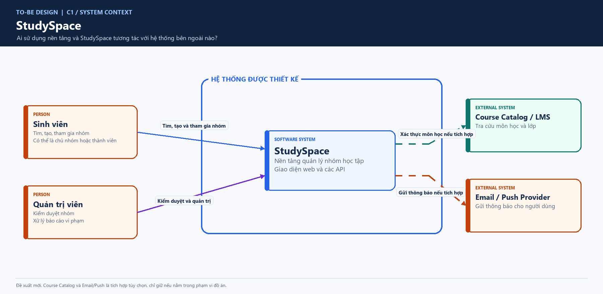
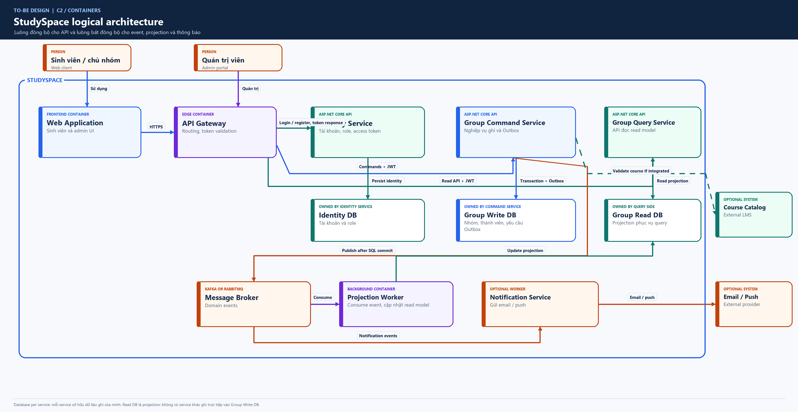
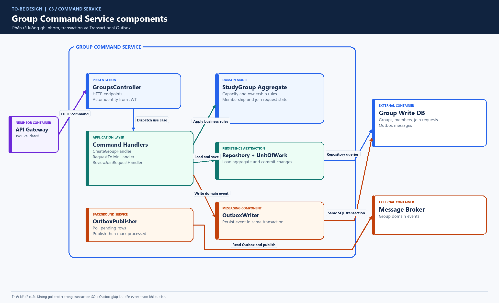
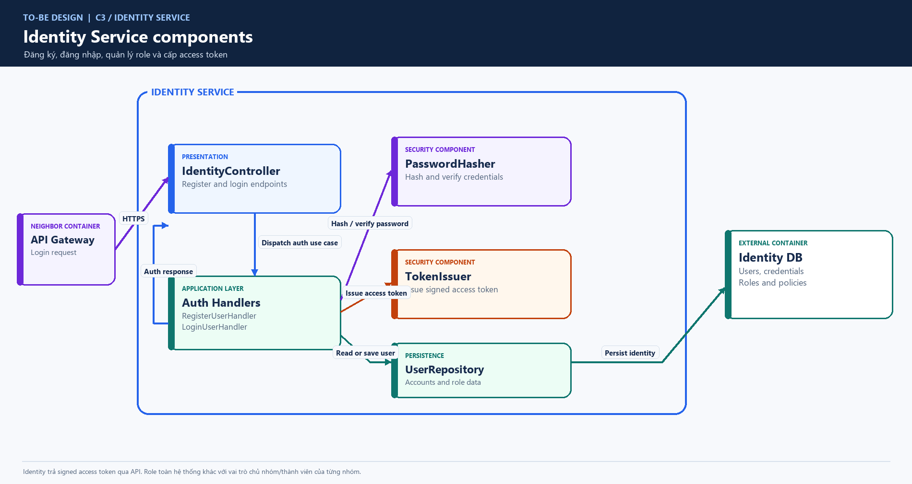
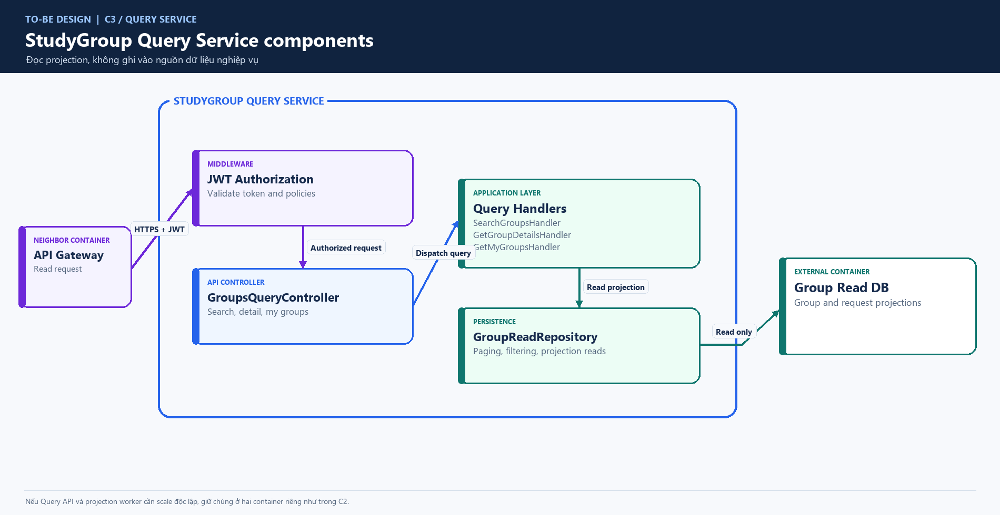
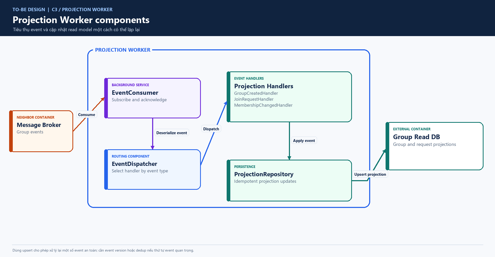
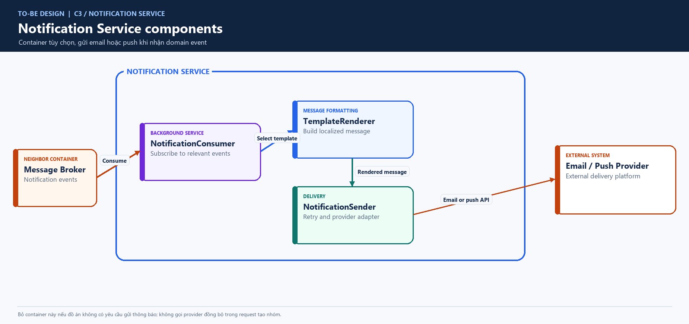
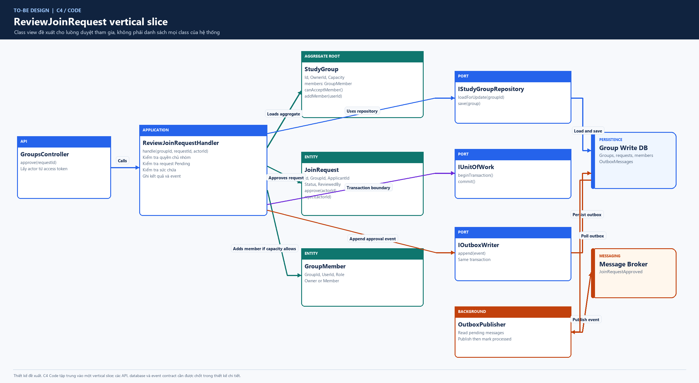

# C4 StudySpace - thiết kế đề xuất

Đây là bộ sơ đồ **To-Be** cho một bài tập mới về xây dựng nền tảng quản lý nhóm học tập theo kiến trúc microservice. Các hình này không mô tả source hiện tại của dự án CQRS.

## Danh sách sơ đồ

### C1 - System Context

### C2 - Containers

### C3 - Components

### C4 - Code

## Giả định thiết kế

- System boundary ở C1/C2 là toàn bộ nền tảng StudySpace; các microservice bên trong được phân rã ở C2.
- Người học có thể là thành viên hoặc chủ nhóm. Quản trị viên là actor riêng nếu bài mới bao gồm kiểm duyệt nhóm và xử lý báo cáo.
- Course Catalog/LMS và Email/Push Provider là tích hợp tùy chọn. Nếu không nằm trong phạm vi triển khai, hãy bỏ khỏi sơ đồ.
- Message Broker là lựa chọn kiến trúc; đồ án cần chọn Kafka **hoặc** RabbitMQ, không triển khai đồng thời cả hai nếu không có yêu cầu.
- Identity DB, Group Write DB và Group Read DB thuộc các service/bounded context khác nhau. Không để service dùng chung database ghi.
- Projection Worker và Notification Service là các container cần được giữ trong thiết kế cuối cùng khi nhóm xác nhận sẽ triển khai và kiểm thử chúng.
- C4 Code chỉ đi sâu vào một vertical slice đại diện: duyệt yêu cầu tham gia.
